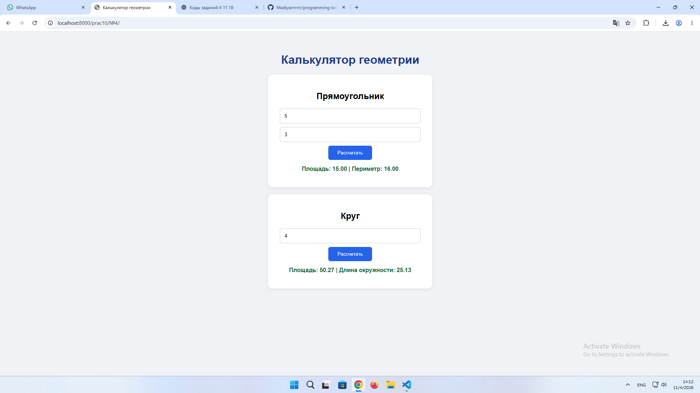
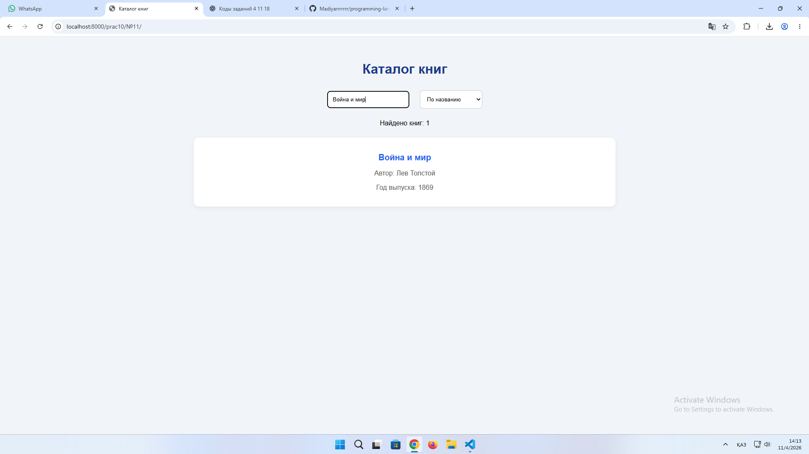
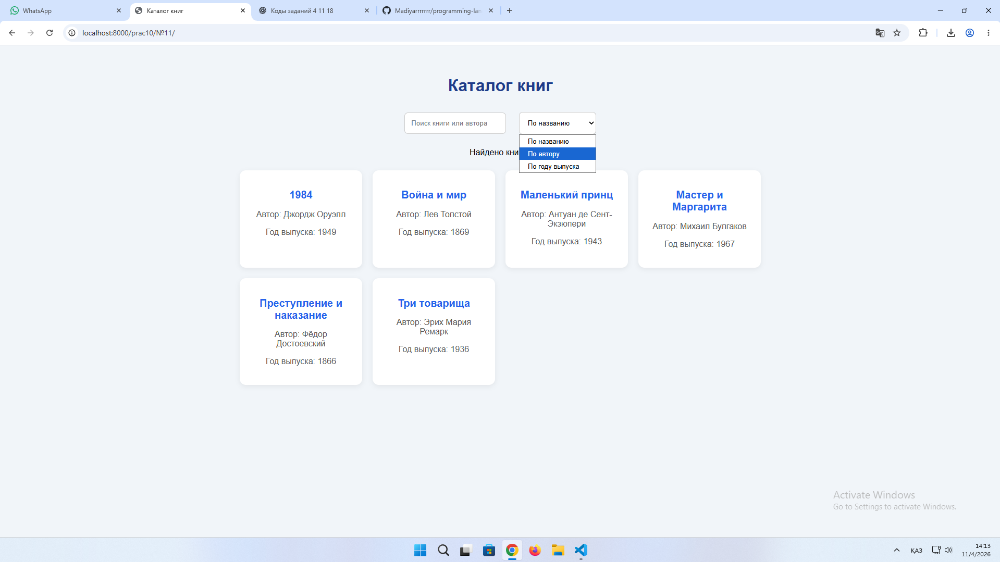
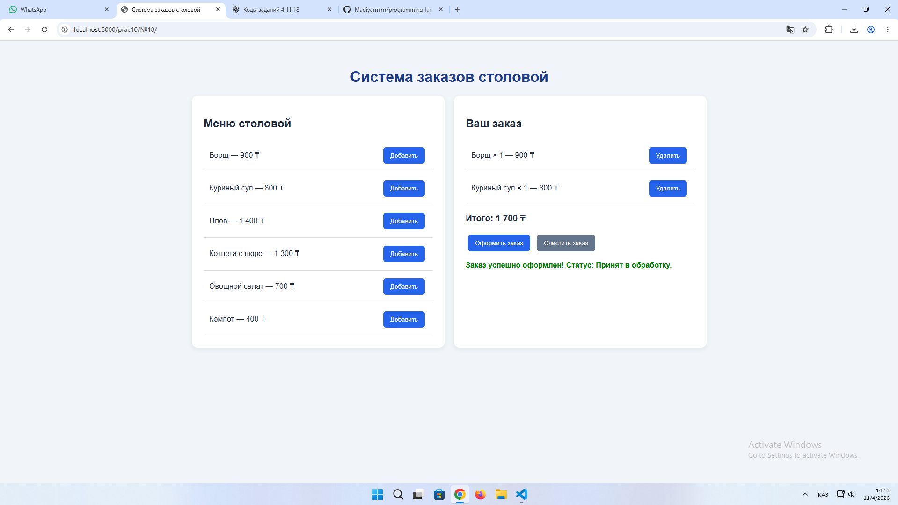

# ОТЧЁТ ПО ЛАБОРАТОРНОЙ РАБОТЕ №10

**Дисциплина:** «Языки и технология программирования»

**Тема:** Основы модульности и структуры проекта: разделение кода на файлы, использование ES-модулей.

**Выполнил:** Жантлеуов Мадияр

**Группа:** ИС 25-22

**Выполненные задания:** №4, №11, №18

---

# СЛАЙД 1. Введение и цели работы

## Цель работы

Цель лабораторной работы — изучить принципы модульной организации JavaScript-приложений, научиться разделять программный код на отдельные файлы, использовать именованный экспорт и импорт функций, а также организовывать взаимодействие между модулями.

В ходе работы необходимо освоить разделение бизнес-логики, данных и пользовательского интерфейса, а также научиться создавать приложения с использованием ES-модулей.

## Используемые технологии

- HTML5 — создание структуры веб-страниц.
- CSS3 — оформление пользовательского интерфейса.
- JavaScript — реализация логики приложений.
- ES Modules — разделение кода на независимые модули.
- import/export — импорт и экспорт функций и данных.
- DOM — динамическое взаимодействие со страницей.
- addEventListener() — обработка пользовательских событий.
- createElement() — создание HTML-элементов.
- Visual Studio Code — среда разработки.
- Live Server / локальный HTTP-сервер — запуск приложений в браузере.

## Выполненные задания

**Задание №4 — «Калькулятор геометрии».**

Создать приложение для вычисления площади и периметра прямоугольника и круга. Формулы вынести в отдельный модуль geometry.js, а интерфейс реализовать в main.js.

**Задание №11 — «Каталог книг».**

Разработать каталог книг с возможностью поиска и сортировки. Модуль books.js отвечает за фильтрацию и сортировку массива, ui.js отображает карточки книг, main.js связывает действия пользователя с модулями.

**Задание №18 — «Система заказов столовой».**

Создать систему заказов столовой с меню, добавлением и удалением блюд, расчётом общей стоимости и изменением статуса заказа. Использовать отдельные модули menu.js, orders.js, pricing.js и ui.js.

---

# СЛАЙД 2. Задание №4 — Калькулятор геометрии

## Условие задания

Разработать модульный калькулятор геометрических фигур, который позволяет вычислять площадь и периметр прямоугольника и круга.

В соответствии с заданием необходимо вынести математические формулы в отдельный модуль geometry.js, а пользовательский интерфейс и обработку событий реализовать в main.js.

## Разбор задания

Для выполнения задания создано веб-приложение, которое содержит два раздела: «Прямоугольник» и «Круг».

В разделе прямоугольника пользователь вводит длину и ширину. После нажатия кнопки «Рассчитать» программа вычисляет площадь и периметр.

Используются следующие формулы:

**Площадь прямоугольника:**

S = a × b

**Периметр прямоугольника:**

P = 2 × (a + b)

Для круга пользователь вводит радиус, после чего приложение рассчитывает площадь и длину окружности.

**Площадь круга:**

S = π × r²

**Длина окружности:**

C = 2 × π × r

Все математические вычисления находятся в файле geometry.js. В main.js импортируются необходимые функции, считываются значения полей и выводятся результаты на страницу.

## Основные этапы выполнения

1. Создать HTML-страницу калькулятора.
2. Добавить поля ввода длины, ширины и радиуса.
3. Создать модуль geometry.js.
4. Реализовать функции вычисления площади и периметра.
5. Импортировать функции в main.js.
6. Добавить обработчики событий кнопок.
7. Реализовать проверку введённых значений.
8. Вывести результаты вычислений на страницу.

## Пример используемого кода

Файл geometry.js:

```javascript
export function rectangleArea(a, b) {
    return a * b;
}

export function rectanglePerimeter(a, b) {
    return 2 * (a + b);
}

export function circleArea(r) {
    return Math.PI * r * r;
}

export function circlePerimeter(r) {
    return 2 * Math.PI * r;
}
```

Импорт функций в main.js:

```javascript
import {
    rectangleArea,
    rectanglePerimeter,
    circleArea,
    circlePerimeter
} from "./modules/geometry.js";
```

## Демонстрация работы — тест №1

**Действие 1:** пользователь вводит длину 5 и ширину 3.

**Результат:**
- Площадь прямоугольника: 15.
- Периметр прямоугольника: 16.

**Действие 2:** пользователь вводит радиус круга 4.

**Результат:**
- Площадь круга: 50,27.
- Длина окружности: 25,13.

**Действие 3:** пользователь оставляет поле пустым или вводит отрицательное значение.

**Результат:** приложение выводит сообщение о необходимости ввести положительное число.

## Результат

Разработан модульный калькулятор геометрии. Реализованы вычисления площади и периметра двух геометрических фигур, импорт и экспорт функций, обработка пользовательских событий и проверка введённых данных.

**Скриншот:** 

---

# СЛАЙД 3. Задание №11 — Каталог книг

## Условие задания

Создать веб-приложение «Каталог книг» с возможностью фильтрации и сортировки массива книг.

В соответствии с требованиями задания необходимо разделить программу на три модуля:

- books.js — фильтрация и сортировка массива книг.
- ui.js — отображение карточек книг.
- main.js — связь модулей и обработка действий пользователя.

## Разбор задания

Для выполнения задания разработан каталог книг, содержащий названия произведений, имена авторов и годы выпуска.

На странице расположено поле поиска, которое позволяет находить книги по названию или автору.

Также реализована сортировка каталога по трём параметрам:

1. По названию книги.
2. По имени автора.
3. По году выпуска.

Для хранения информации используется массив объектов JavaScript.

Функция filterBooks() выполняет поиск по введённому тексту. Функция sortBooks() сортирует полученные результаты в зависимости от выбранного пользователем параметра.

Модуль ui.js отвечает за создание карточек книг и их отображение на странице.

## Алгоритм работы

1. При открытии страницы загружается массив книг.
2. Программа получает данные из модуля books.js.
3. На странице отображаются карточки книг.
4. Пользователь вводит название книги или имя автора.
5. Программа фильтрует массив по введённому значению.
6. Пользователь выбирает способ сортировки.
7. Результаты обновляются без перезагрузки страницы.
8. Если совпадений нет, появляется сообщение «Книги не найдены».

## Пример используемого кода

Файл books.js:

```javascript
export function filterBooks(list, query) {
    const text = query.toLowerCase().trim();

    return list.filter(book =>
        book.title.toLowerCase().includes(text) ||
        book.author.toLowerCase().includes(text)
    );
}

export function sortBooks(list, type) {
    const result = [...list];

    if (type === "year") {
        return result.sort((a, b) => b.year - a.year);
    }

    return result.sort((a, b) =>
        a[type].localeCompare(b[type], "ru")
    );
}
```

Использование функций в main.js:

```javascript
import {
    getBooks,
    filterBooks,
    sortBooks
} from "./modules/books.js";

import {
    renderBooks,
    renderCount
} from "./modules/ui.js";

const books = getBooks();

function updateCatalog() {
    let result = filterBooks(
        books,
        search.value
    );

    result = sortBooks(
        result,
        sort.value
    );

    renderBooks(result);
    renderCount(result.length);
}
```

## Демонстрация работы — тест №2

**Действие 1:** пользователь открывает каталог книг.

**Результат:** отображаются карточки с названиями книг, авторами и годами выпуска.

**Действие 2:** пользователь вводит в поиск слово «1984».

**Результат:** отображается соответствующая книга Джорджа Оруэлла.

**Действие 3:** пользователь выбирает сортировку по автору.

**Результат:** книги сортируются по алфавиту имён авторов.

**Действие 4:** пользователь вводит несуществующее название.

**Результат:** приложение сообщает, что книги не найдены.

## Результат

Создан интерактивный каталог книг с поиском и сортировкой. Реализовано разделение данных, вычислительной логики и отображения интерфейса на независимые JavaScript-модули.

**Скриншот:**  


---

# СЛАЙД 4. Задание №18 — Система заказов столовой

## Условие задания

Разработать веб-приложение «Система заказов столовой», позволяющее пользователю просматривать меню, формировать заказ, рассчитывать стоимость и изменять статус заказа.

В соответствии с заданием необходимо использовать следующие модули:

- menu.js — хранение меню и поиск блюд.
- orders.js — управление составом заказа и его статусом.
- pricing.js — расчёт общей стоимости.
- ui.js — отображение меню и заказа.
- main.js — связь модулей и обработка событий.

## Разбор задания

Для выполнения задания создано веб-приложение столовой с отдельными разделами «Меню столовой» и «Ваш заказ».

В меню представлены различные блюда и напитки с указанием стоимости в тенге.

Пользователь может добавлять блюда в заказ. Если одно и то же блюдо добавляется повторно, увеличивается его количество.

В разделе заказа отображаются выбранные позиции, количество каждого блюда и итоговая стоимость.

Модуль pricing.js отвечает за расчёт общей суммы заказа с использованием метода reduce().

Модуль orders.js управляет добавлением, удалением и очисткой блюд, а также изменением статуса заказа.

После нажатия кнопки «Оформить заказ» приложение проверяет наличие выбранных блюд и изменяет статус на «Принят в обработку».

## Основные функции приложения

1. Отображение списка блюд.
2. Добавление блюд в заказ.
3. Увеличение количества повторно добавленных блюд.
4. Удаление выбранных позиций.
5. Автоматический расчёт общей стоимости.
6. Очистка заказа.
7. Оформление заказа.
8. Отображение текущего статуса заказа.

## Пример используемого кода

Файл pricing.js:

```javascript
export function calculateTotal(order) {
    return order.reduce((sum, item) => {
        return sum + item.price * item.quantity;
    }, 0);
}

export function formatPrice(price) {
    return new Intl.NumberFormat("ru-RU")
        .format(price);
}
```

Файл orders.js:

```javascript
let order = [];
let status = "Не оформлен";

export function addToOrder(item) {
    const existing = order.find(
        x => x.id === item.id
    );

    if (existing) {
        existing.quantity++;
    } else {
        order.push({
            ...item,
            quantity: 1
        });
    }

    status = "Редактируется";
}

export function placeOrder() {
    if (order.length === 0) {
        return false;
    }

    status = "Принят в обработку";
    return true;
}
```

## Демонстрация работы — тест №3

**Действие 1:** пользователь открывает приложение.

**Результат:** отображается меню столовой с названиями блюд и ценами.

**Действие 2:** пользователь добавляет борщ стоимостью 900 ₸ и плов стоимостью 1400 ₸.

**Результат:**
- Борщ — 900 ₸.
- Плов — 1400 ₸.
- Общая стоимость — 2300 ₸.

**Действие 3:** пользователь повторно добавляет борщ.

**Результат:** количество борща увеличивается до двух, общая стоимость становится 3200 ₸.

**Действие 4:** пользователь нажимает кнопку «Оформить заказ».

**Результат:** статус заказа изменяется на «Принят в обработку».

**Действие 5:** пользователь нажимает кнопку «Очистить заказ».

**Результат:** все позиции удаляются, итоговая сумма становится равной нулю.

## Результат

Разработана система заказов столовой с возможностью формирования заказа, автоматического расчёта стоимости и управления статусом. Программа разделена на независимые модули, каждый из которых отвечает за определённую часть приложения.

**Скриншот:** 

---

# СЛАЙД 5. Сводная таблица тестирования

В ходе выполнения лабораторной работы были предусмотрены проверки правильности вычислений, работы поиска, сортировки, формирования заказов и обработки некорректных данных.

| № | Проверка | Ожидаемый результат | Статус |
|---|---|---|---|
| 1 | Расчёт площади прямоугольника | Получение правильного результата | Заполнить после проверки |
| 2 | Расчёт площади круга | Получение правильного результата | Заполнить после проверки |
| 3 | Ввод отрицательного значения | Появляется сообщение об ошибке | Заполнить после проверки |
| 4 | Поиск книги по названию | Отображается нужная книга | Заполнить после проверки |
| 5 | Поиск книги по автору | Отображаются совпадения | Заполнить после проверки |
| 6 | Сортировка книг | Каталог сортируется по выбранному параметру | Заполнить после проверки |
| 7 | Добавление блюда | Блюдо появляется в заказе | Заполнить после проверки |
| 8 | Повторное добавление блюда | Увеличивается количество | Заполнить после проверки |
| 9 | Расчёт общей стоимости | Отображается правильная сумма | Заполнить после проверки |
| 10 | Оформление пустого заказа | Выводится сообщение о необходимости добавить блюда | Заполнить после проверки |

**Примечание:** статус «Пройдено» указывается после фактической проверки приложения.

## Дополнительные проверки

**Задание №4:**
- Проверить вычисление площади прямоугольника.
- Проверить вычисление периметра прямоугольника.
- Проверить вычисление площади и длины окружности.
- Проверить обработку пустых полей и отрицательных значений.

**Задание №11:**
- Проверить поиск по названию.
- Проверить поиск по автору.
- Проверить сортировку по году выпуска.
- Проверить отсутствие результатов поиска.

**Задание №18:**
- Проверить добавление нескольких блюд.
- Проверить повторное добавление одного блюда.
- Проверить удаление позиции.
- Проверить правильность расчёта общей суммы.
- Проверить оформление и очистку заказа.

---

# СЛАЙД 6. Структура проекта и основные технологии

## Структура файлов

Каждое задание реализовано в виде отдельного проекта с использованием HTML, CSS и JavaScript-модулей.

**Task4_Geometry/**

```text
Task4/
├── index.html
├── style.css
└── src/
    ├── main.js
    └── modules/
        └── geometry.js
```

**Task11_BookCatalog/**

```text
Task11/
├── index.html
├── style.css
└── src/
    ├── main.js
    └── modules/
        ├── books.js
        └── ui.js
```

**Task18_CanteenOrders/**

```text
Task18/
├── index.html
├── style.css
└── src/
    ├── main.js
    └── modules/
        ├── menu.js
        ├── orders.js
        ├── pricing.js
        └── ui.js
```

## Назначение файлов

**index.html** — содержит структуру веб-страницы, поля ввода, кнопки и контейнеры для отображения информации.

**style.css** — отвечает за оформление пользовательского интерфейса, карточек, кнопок и других элементов.

**main.js** — главный JavaScript-файл, который импортирует функции из других модулей и обрабатывает пользовательские действия.

**geometry.js** — содержит математические функции для расчёта площади и периметра геометрических фигур.

**books.js** — содержит массив книг и функции фильтрации и сортировки.

**ui.js** — отвечает за отображение информации на странице.

**menu.js** — содержит список блюд и их стоимость.

**orders.js** — управляет составом заказа и его статусом.

**pricing.js** — выполняет расчёт общей стоимости заказа и форматирование денежных значений.

## Основные методы JavaScript

- export — экспортирует функции и данные из модуля.
- import — подключает функции и данные из других модулей.
- addEventListener() — обрабатывает действия пользователя.
- querySelector() — находит элементы HTML.
- createElement() — создаёт новые элементы страницы.
- append() — добавляет элементы в DOM.
- textContent — изменяет текстовое содержимое.
- filter() — фильтрует массив.
- sort() — сортирует массив.
- reduce() — вычисляет итоговое значение массива.
- find() — выполняет поиск элемента.
- replaceChildren() — заменяет содержимое элемента.

## Особенности модульной структуры

Использование ES-модулей позволяет разделить программу на отдельные логические части.

Каждый файл выполняет собственную задачу. Например, вычисления не смешиваются с оформлением страницы, а данные каталога отделены от функций их отображения.

Для подключения модулей используется:

```html
<script type="module" src="./src/main.js"></script>
```

Запуск приложений осуществляется через локальный HTTP-сервер, поскольку ES-модули не рекомендуется запускать напрямую через file://.

---

# СЛАЙД 7. Заключение и выводы

## Итоги работы

В ходе выполнения лабораторной работы №10 были изучены основы модульности и структуры JavaScript-проектов. Были рассмотрены способы разделения программного кода на отдельные файлы, использование import/export и организация взаимодействия между модулями.

В **задании №4** разработан калькулятор геометрии. Реализованы функции вычисления площади и периметра прямоугольника и круга. Математические формулы вынесены в отдельный модуль geometry.js.

В **задании №11** создан каталог книг с возможностью поиска и сортировки. Реализовано разделение данных, функций фильтрации и пользовательского интерфейса.

В **задании №18** разработана система заказов столовой. Реализованы меню, добавление и удаление блюд, расчёт общей стоимости и управление статусом заказа.

## Полученные навыки

- Работа с JavaScript ES-модулями.
- Использование именованного export и import.
- Разделение кода на отдельные файлы.
- Организация структуры каталогов проекта.
- Разработка пользовательских интерфейсов.
- Работа с DOM.
- Обработка пользовательских событий.
- Фильтрация и сортировка массивов.
- Реализация вычислительных функций.
- Разделение бизнес-логики и DOM-интерфейса.
- Проверка корректности работы приложений.

## Общий вывод

В результате выполнения лабораторной работы были закреплены практические навыки модульной разработки веб-приложений на JavaScript.

На примере трёх заданий были изучены принципы организации кода, способы обмена функциями и данными между модулями, а также методы разделения логики приложения и пользовательского интерфейса.

Использование ES-модулей делает программный код более структурированным, понятным и удобным для дальнейшего изменения и сопровождения.

Таким образом, поставленная цель лабораторной работы достигнута: получены практические навыки создания модульных JavaScript-приложений с использованием HTML, CSS и ES Modules.

---

# СЛАЙД 8. Контрольные вопросы

**1. Что такое модуль в JavaScript?**

Модуль — это отдельный JavaScript-файл, который содержит определённые функции, данные или классы и может взаимодействовать с другими файлами через import и export.

**2. Чем ES-модули отличаются от обычных скриптов?**

ES-модули имеют собственную область видимости и поддерживают импорт и экспорт данных между файлами.

**3. Для чего нужен type="module"?**

Этот атрибут указывает браузеру, что подключённый JavaScript-файл необходимо выполнять как ES-модуль.

**4. Как работает именованный export?**

Именованный export позволяет экспортировать отдельные функции, переменные или классы, которые затем импортируются по их именам в фигурных скобках.

**5. Чем default export отличается от named export?**

default export экспортирует одно основное значение модуля без необходимости использовать фигурные скобки при импорте. Named export позволяет экспортировать несколько именованных элементов.

**6. Почему важен путь к импортируемому файлу?**

Путь определяет местоположение модуля. Если путь указан неправильно, браузер не сможет найти и загрузить файл.

**7. Что такое область видимости модуля?**

Это пространство, в котором переменные и функции доступны только внутри соответствующего модуля, если они специально не экспортированы.

**8. Почему модульное приложение удобнее сопровождать?**

Потому что код разделён на небольшие независимые части. Это облегчает поиск ошибок, изменение функций и добавление новых возможностей.

**9. Зачем отделять бизнес-логику от DOM?**

Это позволяет независимо изменять вычисления и пользовательский интерфейс, делает программу более понятной и удобной для тестирования.

**10. Как диагностировать ошибку загрузки модуля?**

Необходимо открыть инструменты разработчика браузера, перейти во вкладки Console и Network, проверить сообщения об ошибках и правильность путей к файлам.

**11. Почему рекомендуется запускать проект через HTTP-сервер?**

Потому что браузеры ограничивают загрузку ES-модулей при открытии HTML-файлов через file://. Локальный HTTP-сервер обеспечивает корректную загрузку модулей.

**12. Что такое циклическая зависимость модулей?**

Это ситуация, когда один модуль импортирует другой, а второй прямо или косвенно импортирует первый. Такие зависимости могут усложнить выполнение и сопровождение программы.

---

# СЛАЙД 9. Дополнительное задание и практическое применение

## Задание №4 — Калькулятор геометрии

Дополнительно приложение можно расширить функцией вычисления площади треугольника, квадрата и других геометрических фигур.

Также можно добавить выбор единиц измерения и сохранение последних вычислений.

## Задание №11 — Каталог книг

Дополнительно можно реализовать возможность добавления новых книг, фильтрацию по жанрам и сохранение каталога в локальном хранилище браузера.

Это позволит использовать приложение не только для поиска, но и для управления небольшой библиотекой.

## Задание №18 — Система заказов столовой

Дополнительно можно реализовать категории блюд, изменение количества позиций, историю заказов и сохранение информации о заказах.

Также можно добавить возможность выбора способа оплаты и отображение времени оформления заказа.

## Общий результат

Выполненные задания демонстрируют практическое применение модульной структуры JavaScript-проектов.

Первое приложение выполняет геометрические вычисления, второе обеспечивает поиск и сортировку книг, а третье позволяет формировать и рассчитывать заказы столовой.

В результате работы были закреплены знания об ES-модулях, разделении программного кода, взаимодействии файлов и динамическом обновлении пользовательского интерфейса.