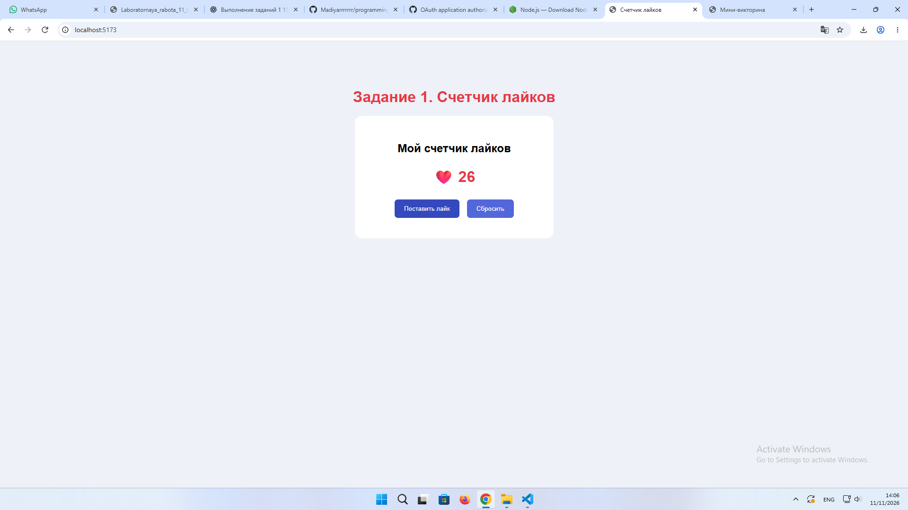
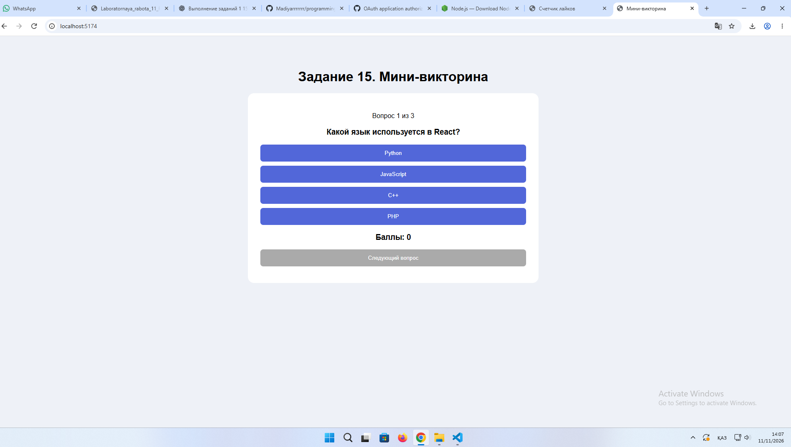
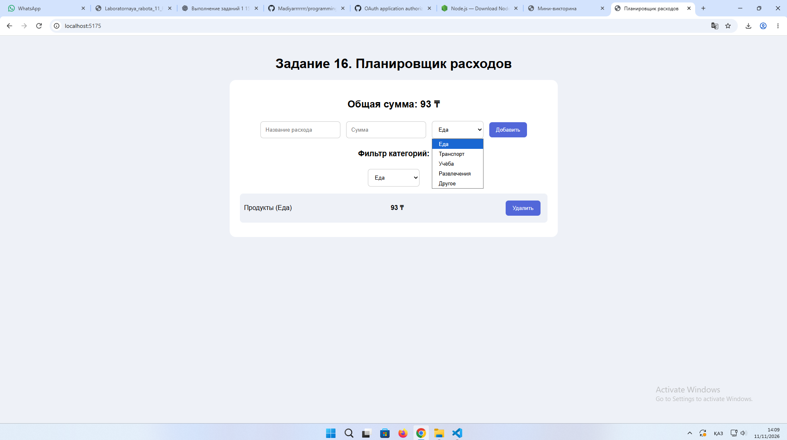

ОТЧЁТ ПО ЛАБОРАТОРНОЙ РАБОТЕ №11
Дисциплина: «Языки и технология программирования»

Тема: Использование React: компоненты, Props и State.

Выполнил: Жантлеуов Мадияр
Группа: ИС 25-22
1. Цель работы
Изучить основы библиотеки React, научиться создавать функциональные компоненты, передавать данные между компонентами с помощью Props и управлять состоянием приложения с помощью State (useState).
2. Выполненные задания
Задание 1. Счётчик лайков
Цель: Создать компонент кнопки лайка с возможностью увеличения и сброса количества лайков.

Описание выполнения:

Был создан компонент LikeButton, который получает название кнопки через Props. Для хранения количества лайков используется хук useState.

При нажатии на кнопку количество лайков увеличивается на единицу. Также предусмотрена кнопка сброса счётчика.

Результат: Разработано приложение, которое позволяет увеличивать и сбрасывать количество лайков.
Скриншот 

Задание 15. Мини-викторина
Цель: Создать небольшую викторину с вопросами и вариантами ответов.

Описание выполнения:

Был создан компонент QuestionCard, который получает данные вопроса через Props.

В родительском компоненте Quiz используются состояния для хранения:
- текущего номера вопроса;
- выбранных ответов;
- количества правильных ответов;
- завершения викторины.
После выбора ответа пользователь переходит к следующему вопросу. В конце отображается результат викторины. Также предусмотрена возможность начать игру заново.

Результат: Создана интерактивная викторина с подсчётом правильных ответов.
Скриншот 

Задание 16. Планировщик расходов
Цель: Разработать приложение для добавления и учёта расходов.

Описание выполнения:

Были созданы компоненты ExpenseForm и ExpenseList.

Компонент ExpenseForm используется для добавления новых расходов. Пользователь вводит название, сумму и категорию расхода.

Компонент ExpenseList отображает добавленные расходы. В родительском компоненте ExpensePlanner хранится список расходов, рассчитывается общая сумма и реализована фильтрация по категориям.

Также предусмотрена возможность удалять отдельные расходы.

Результат: Создано приложение для учёта расходов с возможностью добавления, удаления и фильтрации записей.
Скриншот 

3. Используемые технологии
В ходе лабораторной работы использовались:
- React — библиотека для создания пользовательских интерфейсов.
- JavaScript — язык программирования.
- JSX — синтаксис для создания React-компонентов.
- useState — хук для управления состоянием компонентов.
- Props — механизм передачи данных между компонентами.
- CSS — оформление интерфейса.
- Visual Studio Code — среда разработки.
- Node.js и npm — запуск проекта и установка необходимых библиотек.
4. Результаты работы
В результате выполнения лабораторной работы были разработаны три отдельных React-приложения:
1. Счётчик лайков с увеличением и сбросом значения.
2. Мини-викторина с вопросами и подсчётом правильных ответов.
3. Планировщик расходов с добавлением, удалением и фильтрацией расходов.
Все три приложения запускаются отдельно с помощью команды npm run dev.
5. Вывод
В ходе лабораторной работы я познакомился с основами React и научился создавать функциональные компоненты. На практике изучил передачу данных через Props и управление состоянием с помощью useState. Также получил опыт разработки интерактивных приложений, работы с формами, списками и обработчиками событий.

Поставленная цель лабораторной работы достигнута.

6. Контрольные вопросы и ответы
1. Что такое компонент?

Компонент — это независимая часть пользовательского интерфейса, которая имеет собственное представление и поведение.

2. Для чего нужны props?

Props используются для передачи данных от родительского компонента дочернему компоненту.

3. Почему props считаются входными данными?

Потому что они передаются компоненту извне, обычно родительским компонентом. Дочерний компонент не должен изменять полученные props.

4. Что такое state?

State — это внутреннее состояние компонента, в котором хранятся данные, изменение которых приводит к обновлению интерфейса.

5. Как работает useState?

useState — это React-хук, который позволяет создавать состояние компонента. Он возвращает текущее значение и функцию для его изменения.

6. Когда происходит повторный рендер?

Повторный рендер происходит при изменении состояния компонента или при получении новых props.

7. Как обработать click в React?

Для обработки нажатия используется событие onClick. Например:
<button onClick={handleClick}>Нажать</button>

8. Почему нельзя изменять state прямым присваиванием?

Потому что React может не обнаружить такое изменение и не обновить интерфейс. Для изменения состояния нужно использовать функцию-сеттер, например setCount.

9. Чем локальное состояние отличается от props?

Props передаются компоненту от родителя, а локальное состояние хранится внутри самого компонента и может изменяться с помощью специальных функций.

10. Как передать обработчик из родителя ребёнку?

Нужно передать функцию через props. Например:
<Child onAction={handleClick} />

В дочернем компоненте её можно вызвать при нажатии на кнопку.

11. Что такое управляемое поле ввода?

Это поле формы, значение которого контролируется состоянием React. При вводе текста состояние обновляется через onChange.

12. Как проверить, что два экземпляра компонента независимы?

Нужно создать два одинаковых компонента и изменить состояние одного из них. Если второй компонент не изменился, значит их состояния независимы.