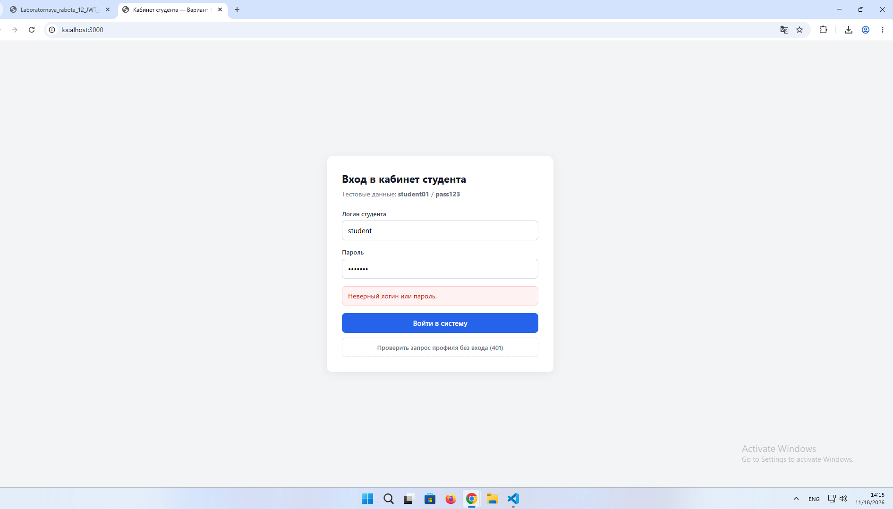
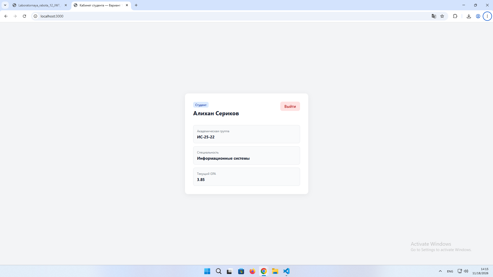
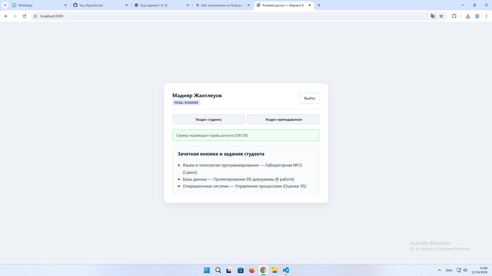
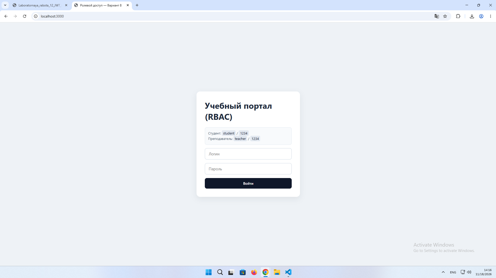
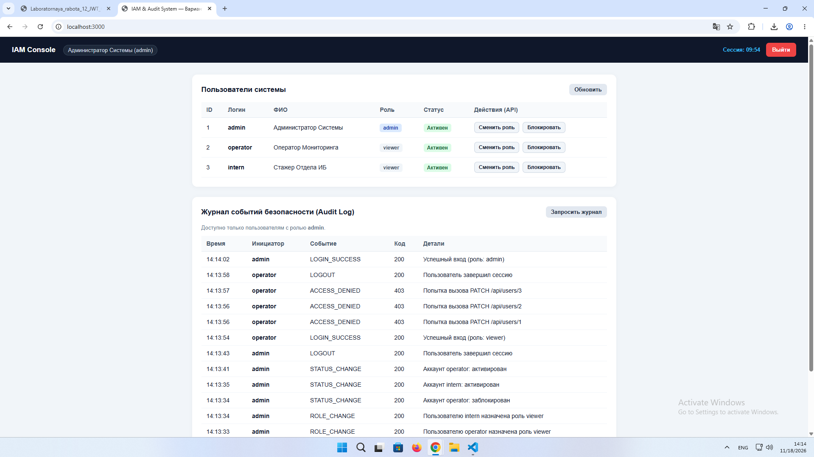
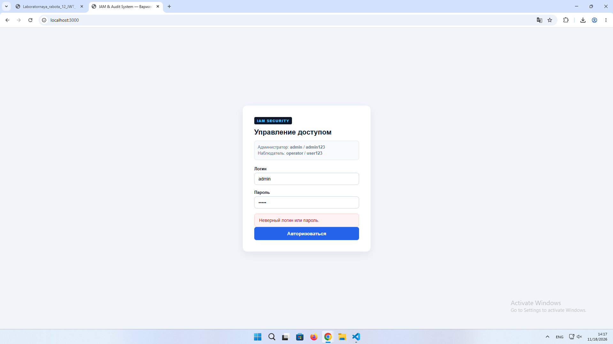
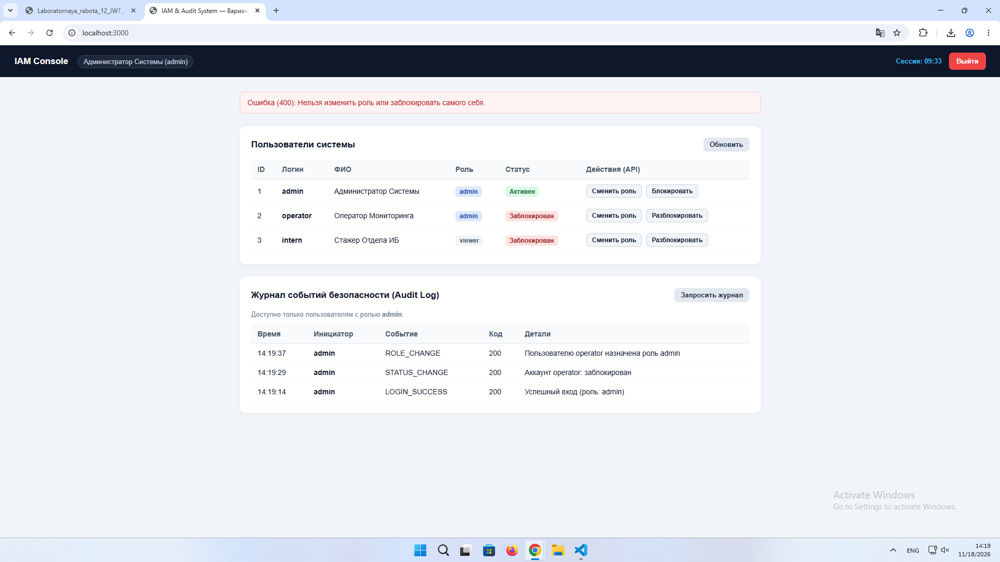

# ОТЧЁТ ПО ЛАБОРАТОРНОЙ РАБОТЕ №12

**Дисциплина:** «Языки и технология программирования»

**Тема:** Аутентификация пользователей, управление ролями и разграничение прав доступа в веб-приложении.

**Выполнил:** Жантлеуов Мадияр  
**Группа:** ИС 25-22

---

## 1. Цель работы

Изучить принципы аутентификации пользователей и управления доступом в веб-приложениях. Научиться создавать форму авторизации, использовать сессии для хранения информации о пользователе, реализовывать разграничение прав доступа в зависимости от роли пользователя, а также создавать систему управления пользователями и журналирования событий.

## 2. Выполненные задания

### Задание 1. Форма входа в личный кабинет студента

**Цель:** Разработать простую систему авторизации пользователя с возможностью входа и выхода из личного кабинета.

**Описание выполнения:**

Было создано веб-приложение с формой авторизации, в которой пользователь вводит логин и пароль.

Для обработки запросов использовались Node.js и Express. Для хранения информации об авторизованном пользователе применялась библиотека express-session.

В приложении реализованы следующие функции:
- Ввод логина и пароля.
- Проверка правильности введённых данных.
- Вывод сообщения при неправильном логине или пароле.
- Создание пользовательской сессии после успешного входа.
- Отображение личного кабинета студента.
- Возможность выхода из системы.

Для проверки работы приложения использовались тестовые данные:

Логин: student  
Пароль: 12345

**Результат:** Разработана система авторизации с проверкой данных, созданием сессии и возможностью выхода из личного кабинета.

**Скриншот:**     

---

### Задание 8. Система управления ролями пользователей

**Цель:** Создать систему авторизации с разделением пользователей на роли Student и Teacher.

**Описание выполнения:**

Было разработано веб-приложение, в котором предусмотрены две категории пользователей: студент и преподаватель.

Для хранения информации о пользователях использовался массив объектов JavaScript. Каждый пользователь имеет логин, пароль, имя и роль.

После авторизации система определяет роль пользователя и отображает соответствующую страницу.

В приложении реализованы:
- Авторизация студента и преподавателя.
- Проверка введённых учётных данных.
- Определение роли пользователя.
- Отображение отдельной страницы для студента.
- Отображение отдельной страницы для преподавателя.
- Проверка прав доступа к страницам.
- Выход из системы с завершением сессии.

**Результат:** Создано приложение с двумя ролями пользователей и разграничением доступа к отдельным страницам в зависимости от уровня прав.

**Скриншот:**       

---

### Задание 16. Система управления пользователями и журнал событий

**Цель:** Разработать систему управления пользователями с административными правами и возможностью отслеживания действий.

**Описание выполнения:**

Было создано веб-приложение, в котором предусмотрены три роли: Student, Teacher и Admin.

Администратор имеет расширенные права и может просматривать список зарегистрированных пользователей, изменять их роли и просматривать журнал событий.

Для разграничения доступа были созданы функции проверки авторизации и проверки административных прав.

В приложении реализованы:
- Авторизация пользователей.
- Разделение пользователей по ролям.
- Просмотр списка пользователей.
- Изменение роли выбранного пользователя.
- Проверка прав администратора.
- Запись событий входа и выхода.
- Запись неудачных попыток авторизации.
- Запись изменений ролей пользователей.
- Просмотр журнала событий.

**Результат:** Разработана система управления пользователями с административной панелью, разграничением прав доступа и журналом событий.

**Скриншот:**                  

---

## 3. Используемые технологии

В ходе лабораторной работы использовались следующие технологии:

- **JavaScript** — основной язык программирования.
- **Node.js** — среда выполнения JavaScript на сервере.
- **Express.js** — фреймворк для создания серверной части приложения.
- **Express-session** — библиотека для управления пользовательскими сессиями.
- **HTML5** — создание структуры веб-страниц.
- **CSS** — оформление пользовательского интерфейса.
- **Fetch API** — отправка запросов между клиентской и серверной частями приложения.
- **JSON** — формат передачи данных.
- **Visual Studio Code** — среда разработки.
- **npm** — установка необходимых библиотек и запуск проекта.

## 4. Результаты работы

В результате выполнения лабораторной работы были разработаны три отдельных веб-приложения:

1. Форма авторизации с личным кабинетом студента и возможностью выхода из системы.
2. Система управления ролями Student и Teacher с разными страницами и правами доступа.
3. Административная система управления пользователями с изменением ролей и журналом событий.

Все три приложения запускаются отдельно с помощью Node.js и Express.

Для запуска каждого проекта использовались команды:

`npm install`

`npm start`

После запуска приложение открывается в браузере по адресу `http://localhost:3000`.

## 5. Вывод

В ходе выполнения лабораторной работы я изучил основы аутентификации пользователей и управления доступом в веб-приложениях.

На практике научился создавать формы авторизации, проверять введённые данные, работать с пользовательскими сессиями и обрабатывать запросы с помощью Express.js.

Также получил практические навыки разделения пользователей по ролям, ограничения доступа к страницам и создания административной панели.

Дополнительно изучил принцип ведения журнала событий, который позволяет отслеживать действия пользователей в системе.

**Поставленная цель лабораторной работы достигнута.**

---

## 6. Контрольные вопросы и ответы

**1. Что такое аутентификация?**

Аутентификация — это процесс проверки личности пользователя при входе в систему. Обычно для этого используются логин и пароль.

**2. Для чего используется Express.js?**

Express.js — это фреймворк для Node.js, который помогает создавать серверы, обрабатывать запросы и создавать маршруты веб-приложения.

**3. Что такое пользовательская сессия?**

Сессия — это способ хранения информации о пользователе между запросами. Благодаря ей система помнит, что пользователь уже вошёл в аккаунт.

**4. Для чего используется express-session?**

Эта библиотека позволяет создавать и управлять пользовательскими сессиями в приложении Express.

**5. Что такое авторизация?**

Авторизация — это проверка того, какие действия разрешено выполнять пользователю после входа в систему.

**6. Что такое роль пользователя?**

Роль определяет права пользователя в системе. Например, студент может просматривать учебные материалы, а администратор — управлять пользователями.

**7. Чем отличаются Student, Teacher и Admin?**

Student — студент, который использует учебные материалы. Teacher — преподаватель, который работает с учебными группами. Admin — администратор, который управляет пользователями и их правами.

**8. Для чего нужна проверка прав доступа?**

Она необходима для ограничения доступа к определённым страницам и функциям. Например, только администратор может изменять роли пользователей.

**9. Что такое middleware в Express.js?**

Middleware — это промежуточная функция, которая выполняется при обработке запроса. Она может проверять авторизацию, права доступа или обрабатывать данные.

**10. Для чего используется метод POST?**

POST используется для отправки данных на сервер. Например, при входе в систему логин и пароль отправляются с помощью POST-запроса.

**11. Для чего используется метод GET?**

GET используется для получения информации с сервера. Например, для просмотра списка пользователей или информации о текущем аккаунте.

**12. Что такое журнал событий?**

Журнал событий — это список действий, которые происходили в системе. В нём могут сохраняться входы, выходы, неудачные попытки авторизации и изменения ролей.

**13. Для чего используется JSON?**

JSON — это формат передачи данных между клиентской и серверной частями приложения. Он позволяет удобно передавать информацию в виде объектов и массивов.

**14. Что происходит при выходе пользователя из системы?**

При выходе уничтожается текущая сессия пользователя. После этого для доступа к защищённым страницам необходимо снова авторизоваться.

**15. Почему необходимо разграничивать права доступа?**

Это необходимо для безопасности приложения. Разграничение прав позволяет ограничить доступ к важным функциям и не разрешать обычным пользователям выполнять действия администратора.

**16. Для чего нужен журналирование действий пользователей?**

Журналирование позволяет отслеживать действия пользователей, контролировать работу системы и выявлять подозрительные или ошибочные действия.