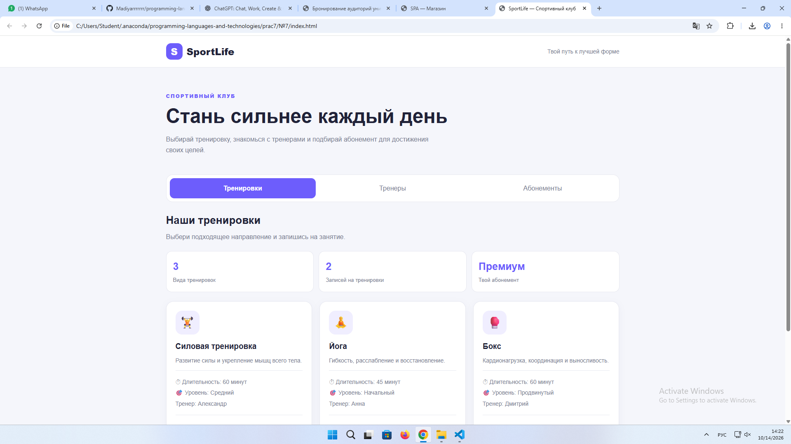
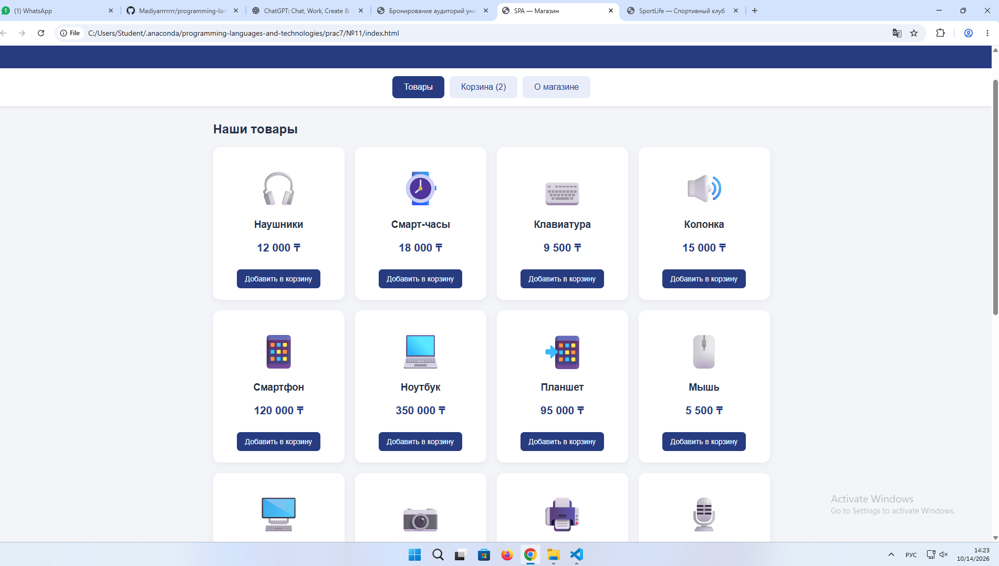
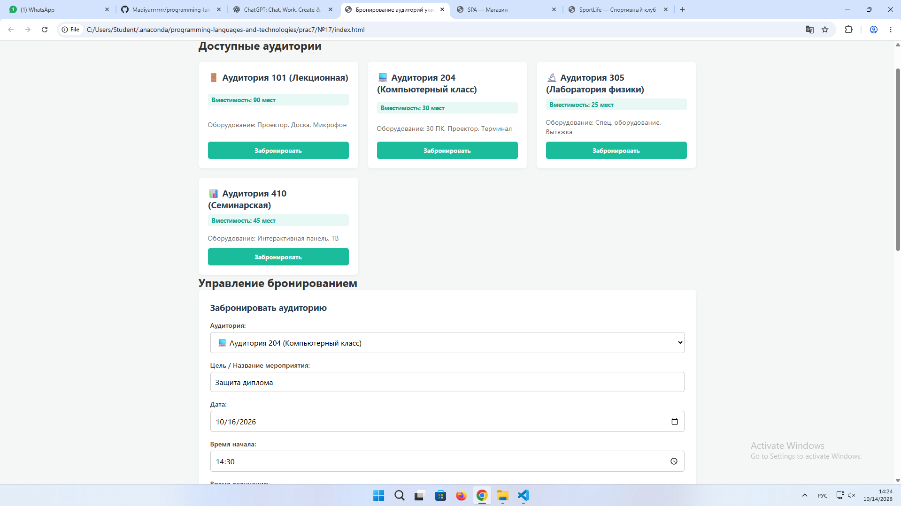

Дисциплина: «Языки и технология программирования»

Тема: Создание простого одностраничного приложения (SPA) без фреймворков: навигация по вкладкам, динамическая подгрузка контента.

Выполнил: Жантлеуов Мадияр / ИС 25 22

🧭 СЛАЙД 1: Введение и цели
🎯 Цель работы

Освоить практическое создание одностраничных веб-приложений (SPA) с использованием HTML5, CSS3 и JavaScript без применения фреймворков. Научиться создавать навигацию по вкладкам, динамически изменять содержимое страницы, обрабатывать события пользователя и управлять DOM.

🛠 Стек технологий
Языки: HTML5, CSS3, JavaScript.
Среда разработки: Visual Studio Code и веб-браузер.
Технологии: DOM, обработка событий, CSS-классы, динамическое создание элементов.
Основные методы: querySelector(), querySelectorAll(), createElement(), append(), addEventListener(), textContent, classList.
Принцип работы: переключение разделов без полной перезагрузки страницы.
📌 Выполненные задания
Вариант № 7 — SPA «Спортклуб». Вкладки «Тренировки», «Тренеры», «Абонементы».
Вариант № 11 — SPA «Магазин». Вкладки «Товары», «Корзина», «О магазине».
Вариант № 17 — SPA «Бронирование аудиторий». Вкладки «Аудитории», «Бронирования», «Правила».
🏋️ СЛАЙД 2: Задание № 7 — SPA «Спортклуб»
Условие

Создать одностраничное приложение для спортивного клуба с тремя вкладками: «Тренировки», «Тренеры» и «Абонементы». Реализовать переключение разделов без перезагрузки страницы и визуальное выделение активной вкладки с помощью CSS.

🔍 Разбор задания

Для навигации используются кнопки с атрибутом data-page. При нажатии на кнопку JavaScript определяет нужный раздел и отображает соответствующее содержимое.

Для получения элементов страницы используются методы DOM:

const tabs = document.querySelectorAll("[data-page]");
const content = document.querySelector("#content");

Для обработки нажатий применяется addEventListener():

tabs.forEach((tab) => {
    tab.addEventListener("click", () => {
        showPage(tab.dataset.page);
    });
});

Для визуального выделения выбранной вкладки используется classList:

tabs.forEach((tab) => {
    tab.classList.toggle(
        "active",
        tab.dataset.page === page
    );
});

Содержимое разделов хранится в объекте JavaScript и выводится в зависимости от выбранной вкладки.

🖥️ Демонстрация работы — Тест 1

Начальное состояние:

► Открывается страница спортивного клуба.

► По умолчанию отображается вкладка «Тренировки».

Действие:

► Пользователь нажимает вкладку «Тренеры».

Результат:

✔ Отображается информация о тренерах.

✔ Активная вкладка выделяется стилями CSS.

✔ Содержимое страницы меняется без перезагрузки.

При нажатии на вкладку «Абонементы» отображаются доступные варианты посещения клуба.

Результат

Создан интерфейс SPA «Спортклуб» с тремя разделами. Реализованы обработка событий, динамическое переключение содержимого и оформление активной вкладки.

Скриншоты: 

🛒 СЛАЙД 3: Задание № 11 — SPA «Магазин»
Условие

Создать одностраничное приложение интернет-магазина с вкладками «Товары», «Корзина» и «О магазине». Реализовать динамический вывод товаров, добавление товаров в корзину и пересчёт количества товаров без перезагрузки страницы.

🔍 Разбор задания

Информация о товарах хранится в массиве объектов JavaScript. Каждый объект содержит название, цену и другие необходимые характеристики товара.

Пример структуры данных:

const products = [
    {
        id: 1,
        name: "Наушники",
        price: 5000
    },
    {
        id: 2,
        name: "Клавиатура",
        price: 8000
    },
    {
        id: 3,
        name: "Мышь",
        price: 3000
    }
];

Для отображения товаров создаются HTML-элементы средствами JavaScript:

function renderProducts() {
    const productsContainer =
        document.querySelector("#products");

    productsContainer.replaceChildren();

    products.forEach((product) => {
        const card = document.createElement("div");
        const name = document.createElement("h3");
        const price = document.createElement("p");
        const button = document.createElement("button");

        name.textContent = product.name;
        price.textContent = `${product.price} ₸`;
        button.textContent = "Добавить в корзину";

        button.addEventListener("click", () => {
            addToCart(product.id);
        });

        card.append(name, price, button);
        productsContainer.append(card);
    });
}

При нажатии на кнопку товар добавляется в корзину, а счётчик обновляется.

function addToCart(productId) {
    const product = products.find(
        item => item.id === productId
    );

    if (!product) return;

    cart.push(product);
    updateCartCounter();
}

В данном примере предполагается, что массив cart и функция updateCartCounter() объявлены в приложении. При повторном добавлении одного товара он учитывается как отдельная единица.

🖥️ Демонстрация работы — Тест 2

Начальное состояние:

► Открывается вкладка «Товары».

► На странице отображается список товаров с ценами.

Действие 1:

► Пользователь нажимает кнопку «Добавить в корзину» у товара «Наушники».

Результат:

✔ Товар добавляется в корзину.

✔ Счётчик товаров увеличивается на единицу.

Действие 2:

► Пользователь открывает вкладку «Корзина».

Результат:

✔ Отображается добавленный товар.

✔ Показывается информация о количестве товаров и их стоимости.

Действие 3:

► Пользователь переходит во вкладку «О магазине».

Результат:

✔ Отображается информация о магазине.

✔ Переход между разделами происходит без перезагрузки страницы.

Результат

Разработано SPA «Магазин» с динамическим отображением товаров, добавлением позиций в корзину и пересчётом количества товаров. Все действия выполняются средствами JavaScript и DOM.

Скриншоты: 

🏫 СЛАЙД 4: Задание № 17 — SPA «Бронирование аудиторий»
Условие

Создать одностраничное приложение для бронирования учебных аудиторий. Реализовать вкладки «Аудитории», «Бронирования» и «Правила», форму добавления бронирования и проверку пересечения времени.

🔍 Разбор задания

Для хранения информации об аудиториях и бронированиях используются массивы объектов JavaScript.

Пример структуры данных:

const rooms = [
    {
        id: 1,
        name: "Аудитория 101",
        capacity: 30
    },
    {
        id: 2,
        name: "Аудитория 202",
        capacity: 20
    }
];

const bookings = [];

Для создания бронирования пользователь указывает аудиторию, дату, время начала и время окончания.

Перед добавлением записи выполняется проверка корректности времени и наличия пересечений с существующими бронированиями.

function hasConflict(newBooking) {
    return bookings.some((booking) => {
        if (
            booking.roomId !== newBooking.roomId ||
            booking.date !== newBooking.date
        ) {
            return false;
        }

        return (
            newBooking.start < booking.end &&
            newBooking.end > booking.start
        );
    });
}

Условие проверяет, пересекаются ли временные интервалы для одной аудитории в один день. Если время окончания одной записи совпадает со временем начала другой, конфликт не возникает.

Перед сохранением необходимо также проверить, что время начала меньше времени окончания.

function createBooking(booking) {
    if (booking.start >= booking.end) {
        alert("Время окончания должно быть позже начала!");
        return;
    }

    if (hasConflict(booking)) {
        alert("Аудитория уже занята в это время!");
        return;
    }

    bookings.push(booking);
    renderBookings();
}

Здесь предполагается, что объект booking содержит корректные поля roomId, date, start и end, а функция renderBookings() обновляет список бронирований на странице.

🖥️ Демонстрация работы — Тест 3

Начальное состояние:

► Открывается вкладка «Аудитории».

► На странице отображается список доступных помещений и их вместимость.

Действие 1:

► Пользователь выбирает аудиторию 101.

► Указывает дату и время с 10:00 до 11:00.

► Подтверждает бронирование.

Результат:

✔ Запись добавляется в список бронирований.

✔ Информация отображается во вкладке «Бронирования».

Действие 2:

► Пользователь пытается забронировать ту же аудиторию на ту же дату с 10:30 до 11:30.

Результат:

✔ Система обнаруживает пересечение времени.

✔ Повторное бронирование не добавляется.

✔ Пользователь получает сообщение о конфликте.

Действие 3:

► Пользователь открывает вкладку «Правила».

Результат:

✔ Отображаются правила использования аудиторий и условия бронирования.

Результат

Создано SPA «Бронирование аудиторий» с динамическим отображением помещений, добавлением бронирований и проверкой пересечения временных интервалов. Проверка позволяет предотвратить одновременное бронирование одной аудитории несколькими пользователями в рамках текущего приложения.

Скриншоты: 

📊 СЛАЙД 5: Сводная таблица тестов
№	Проверка	Ожидаемый результат	Статус
1	Открытие SPA «Спортклуб»	Отображается стартовая вкладка	PASS*
2	Переключение вкладок спортклуба	Содержимое меняется без перезагрузки	PASS*
3	Добавление товара в корзину	Счётчик увеличивается	PASS*
4	Просмотр корзины	Добавленный товар отображается	PASS*
5	Создание корректного бронирования	Запись добавляется в список	PASS*
6	Попытка пересекающегося бронирования	Система сообщает об ошибке	PASS*
7	Время окончания раньше начала	Бронирование отклоняется	PASS*

* Статус PASS следует указывать после фактического выполнения соответствующей проверки. Если тест ещё не проводился, укажи «Не проверено».

Дополнительные проверки

Задание № 7 — Спортклуб

Повторное нажатие на активную вкладку.
Переключение между всеми тремя разделами.
Проверка оформления активной вкладки.

Задание № 11 — Магазин

Добавление нескольких товаров.
Повторное добавление одного товара.
Проверка правильности количества товаров в корзине.

Задание № 17 — Бронирование аудиторий

Создание двух бронирований в разное время.
Попытка создать пересекающиеся бронирования.
Ввод некорректного временного интервала.
Проверка бронирований для разных аудиторий.
💻 СЛАЙД 6: Структура проекта и основные технологии
Структура файлов

Проект состоит из трёх основных файлов:

Lab7_SPA/
├── index.html
├── style.css
└── app.js

index.html — содержит структуру страницы, меню навигации и контейнер для содержимого.

style.css — отвечает за оформление приложения, карточек, кнопок и активной вкладки, а также адаптацию интерфейса к узкому экрану.

app.js — содержит данные разделов, обработчики событий, функции переключения вкладок и дополнительную функциональность каждого варианта.

Основной принцип SPA
Пользователь нажимает на вкладку.
JavaScript обрабатывает событие через addEventListener().
Определяется нужный раздел по атрибуту data-page.
Содержимое контейнера изменяется средствами DOM.
Активная вкладка получает CSS-класс active.

Полная перезагрузка HTML-страницы при переключении разделов не требуется.

Использованные методы JavaScript
querySelector() — поиск элемента по CSS-селектору.
querySelectorAll() — поиск нескольких элементов.
addEventListener() — обработка действий пользователя.
createElement() — создание новых HTML-элементов.
append() — добавление элементов в DOM.
textContent — изменение текстового содержимого.
classList.add() и classList.toggle() — управление CSS-классами.
Array.prototype.find() — поиск товара по идентификатору.
Array.prototype.some() — проверка наличия пересечения времени.
🏁 СЛАЙД 7: Заключение и выводы
💡 Итоги работы

В ходе лабораторной работы были разработаны три концепции одностраничных веб-приложений на чистом JavaScript без использования React, Vue, Angular и других SPA-фреймворков.

В задании № 7 реализован интерфейс спортивного клуба с навигацией по вкладкам и визуальным выделением активного раздела.

В задании № 11 разработан интерфейс интернет-магазина с динамическим отображением товаров, добавлением товаров в корзину и обновлением счётчика.

В задании № 17 реализован интерфейс бронирования аудиторий с формой создания записей и проверкой пересечения временных интервалов.

🏆 Полученные навыки
Работа с DOM и поиск HTML-элементов.
Обработка событий пользователя с помощью addEventListener().
Динамическое создание и изменение содержимого страницы.
Хранение и обработка данных в объектах и массивах JavaScript.
Управление CSS-классами и оформление активных вкладок.
Проверка пользовательского ввода.
Реализация простой бизнес-логики для корзины и бронирования.
Тестирование интерактивных веб-интерфейсов.
📝 Общий вывод

В результате выполнения лабораторной работы были закреплены навыки разработки одностраничных приложений с использованием HTML5, CSS3 и JavaScript. Были рассмотрены принципы организации навигации по вкладкам, динамического изменения содержимого и обработки действий пользователя без полной перезагрузки страницы.

Практическая реализация трёх вариантов позволила применить DOM для решения разных задач: отображения информации, управления товарами и проверки корректности бронирования помещений. Полученные знания являются основой для дальнейшего изучения клиентской веб-разработки.

❓ СЛАЙД 8: Контрольные вопросы

1. Что означает SPA и чем оно отличается от многостраничного сайта?

SPA (Single Page Application) — одностраничное приложение, в котором переходы между разделами выполняются внутри одной HTML-страницы. В отличие от традиционного многостраничного сайта, при переключении разделов обычно не требуется полная перезагрузка страницы.

2. Как переключать вкладки без перезагрузки страницы?

Необходимо обрабатывать клики по кнопкам навигации и программно изменять содержимое нужного DOM-элемента.

3. Как найти и изменить элемент DOM?

Для поиска используются querySelector() и querySelectorAll(). Содержимое элемента можно изменить через textContent, а оформление — через classList.

4. Зачем нужен addEventListener()?

Метод позволяет назначить обработчик события, например клика по кнопке или ввода с клавиатуры.

5. Для чего используются data-атрибуты?

data-* позволяют хранить дополнительные данные в HTML-элементах. В SPA атрибут data-page может обозначать раздел, который следует открыть после нажатия кнопки.

6. Чем textContent отличается от innerHTML?

textContent работает с текстом, а innerHTML позволяет устанавливать HTML-разметку. Для отображения пользовательского текста предпочтительнее textContent, поскольку он не интерпретирует содержимое как HTML.

7. Как выделить активную вкладку?

С помощью CSS-класса, например active, который добавляется выбранной вкладке и удаляется у остальных.

8. Как организовать данные нескольких разделов?

Данные можно хранить в объекте, свойства которого соответствуют разделам, или в массивах объектов для списков товаров, тренировок и аудиторий.

9. Как проверить пересечение временных интервалов?

Для интервалов [start, end) пересечение существует, если начало нового интервала меньше конца существующего, а конец нового интервала больше начала существующего. Дополнительно необходимо учитывать аудиторию и дату.

10. Как проверить корректность работы SPA?

Следует проверить стартовую загрузку, переключение вкладок, повторные действия, корректный ввод и обработку ошибочных ситуаций. Результаты фиксируются в таблице тестирования.

⭐ СЛАЙД 9: Дополнительное задание

В качестве дополнительной функциональности рассматривается адаптивная навигация с выделением активной вкладки и динамическое обновление данных интерфейса.

Задание № 7 — Спортклуб

При выборе вкладки автоматически изменяется её оформление. Это помогает пользователю понимать, в каком разделе приложения он находится.

Задание № 11 — Магазин

При добавлении товара обновляется счётчик корзины. Пользователь сразу видит количество добавленных позиций без перезагрузки страницы.

Задание № 17 — Бронирование аудиторий

Перед сохранением новой записи проверяется пересечение временных интервалов. Это предотвращает создание конфликтующих бронирований в рамках приложения.

Общий результат

Дополнительные функции делают интерфейс понятнее, повышают удобство работы и демонстрируют практическое использование событий JavaScript, DOM и алгоритмов проверки данных.