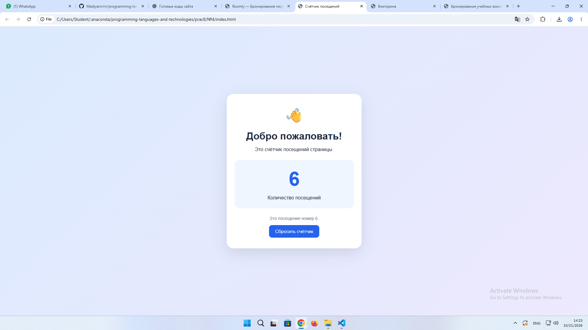
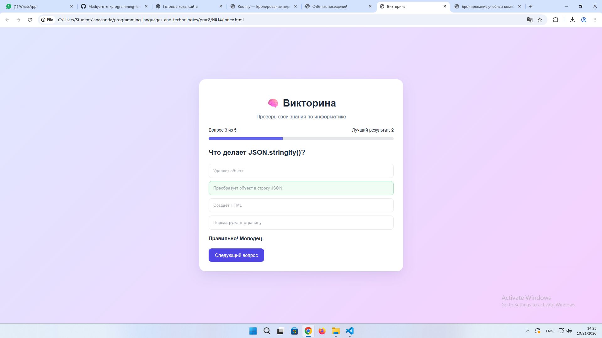
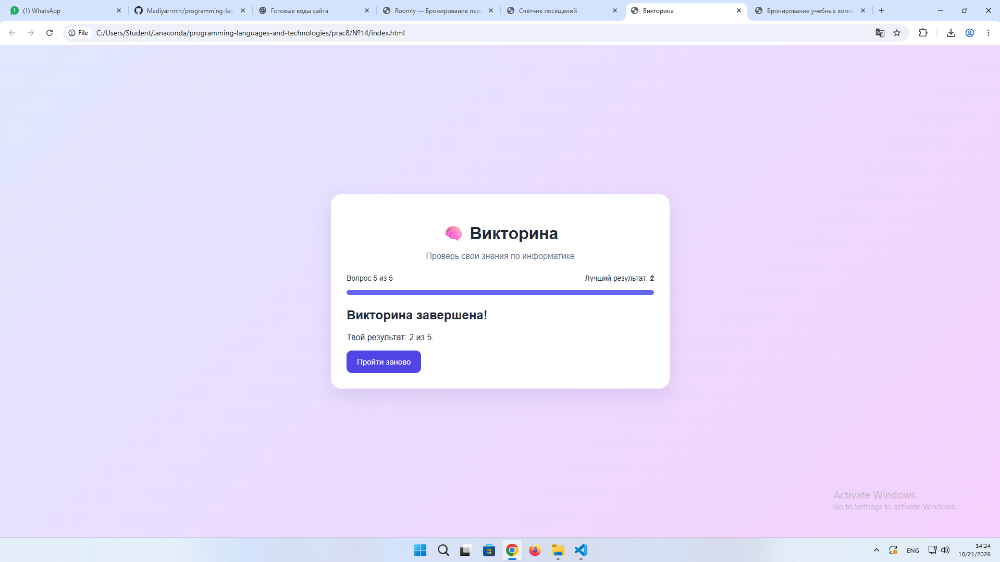
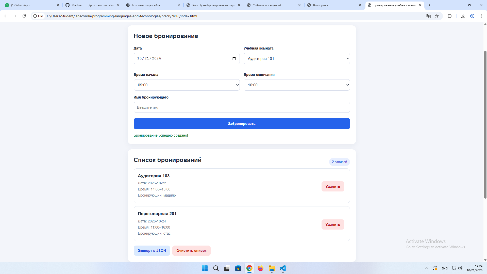
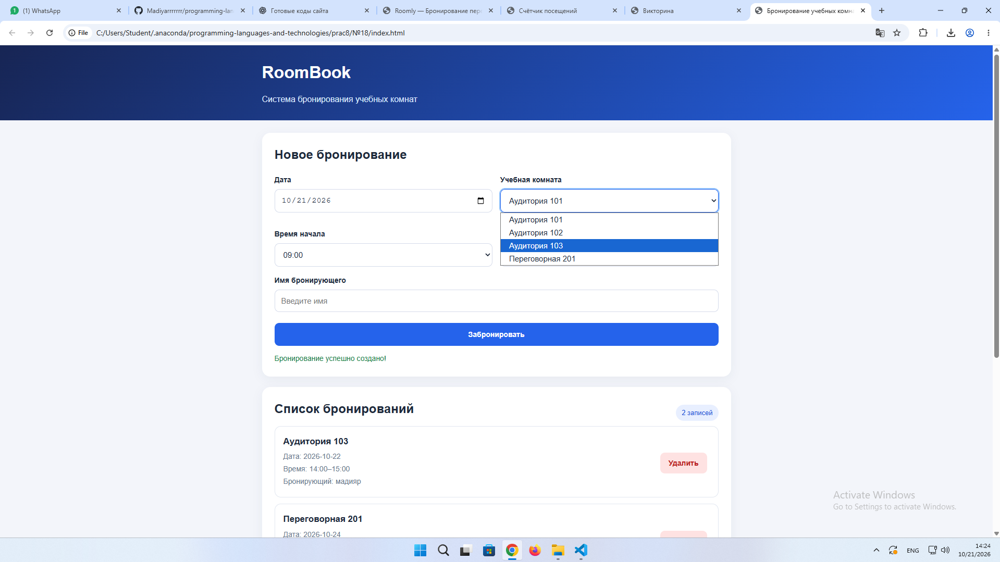

# ОТЧЁТ ПО ЛАБОРАТОРНОЙ РАБОТЕ №8

**Дисциплина:** «Языки и технология программирования»

**Тема:** Работа с JSON и локальным хранилищем (LocalStorage, SessionStorage): сохранение и загрузка пользовательских данных.

**Выполнил:** Жантлеуов Мадияр  
**Группа:** ИС 25-22

**Выполненные задания:** №4, №14, №18

---

# СЛАЙД 1. Введение и цели работы

## Цель работы

Освоить сериализацию и десериализацию объектов JavaScript в формате JSON, научиться сохранять и загружать пользовательские данные с помощью localStorage и sessionStorage. Реализовать восстановление состояния приложения после обновления страницы, обработку событий пользователя и удаление сохранённых записей.

## Используемые технологии

- **HTML5** — создание структуры веб-страниц.
- **CSS3** — оформление пользовательского интерфейса.
- **JavaScript** — реализация логики приложений.
- **JSON** — формат хранения структурированных данных.
- **localStorage** — сохранение информации между перезапусками браузера.
- **sessionStorage** — хранение текущего прогресса в рамках вкладки браузера.
- **Visual Studio Code** — среда разработки.
- **Live Server** — запуск проекта в браузере.

## Выполненные задания

**Вариант №4 — «Счётчик посещений страницы».**  
Реализовать увеличение количества посещений страницы и сохранение числа в localStorage.

**Вариант №14 — «Викторина».**  
Создать викторину с вопросами из массива объектов, сохранить лучший результат в localStorage и текущий прогресс в sessionStorage.

**Вариант №18 — «Система бронирования учебных комнат».**  
Разработать приложение для бронирования помещений с выбором даты, времени и комнаты, сохранением записей и проверкой конфликтов.

---

# СЛАЙД 2. Задание №4 — Счётчик посещений страницы

## Условие задания

Создать веб-приложение, которое увеличивает количество посещений страницы и отображает сохранённое значение после обновления. Для хранения данных использовать localStorage.

## Разбор задания

Для реализации счётчика используется ключ `lab8_visit_count`, в котором хранится количество посещений страницы.

При открытии приложения JavaScript получает сохранённое значение с помощью метода `getItem()`. Если данные отсутствуют, счётчик начинается с нуля. Затем число увеличивается на единицу и сохраняется в localStorage.

Для преобразования числа в JSON используется метод `JSON.stringify()`, а для восстановления значения — `JSON.parse()`.

Пример сохранения данных:

```javascript
const STORAGE_KEY = "lab8_visit_count";

const visits = 5;

localStorage.setItem(
    STORAGE_KEY,
    JSON.stringify(visits)
);
```

Пример загрузки данных:

```javascript
const saved = localStorage.getItem(STORAGE_KEY);

const visits = saved === null
    ? 0
    : JSON.parse(saved);
```

Для сброса счётчика предусмотрена отдельная кнопка. После её нажатия сохранённое значение устанавливается в ноль.

## Демонстрация работы — тест №1

**Начальное состояние:**

- Открывается страница счётчика посещений.
- Приложение получает сохранённое число из localStorage.

**Действие 1:**

Пользователь открывает страницу.

**Результат:**

- Счётчик увеличивается на единицу.
- Новое значение отображается на экране.
- Число сохраняется в localStorage.

**Действие 2:**

Пользователь обновляет страницу.

**Результат:**

- Сохранённое значение восстанавливается.
- Счётчик увеличивается при новом открытии страницы.

**Действие 3:**

Пользователь нажимает кнопку сброса.

**Результат:**

- Значение счётчика становится равным нулю.
- Новое значение сохраняется в хранилище.

## Результат

Разработано приложение «Счётчик посещений». Реализованы автоматическое увеличение числа посещений, сохранение данных в localStorage, восстановление значения после обновления страницы и сброс счётчика.

**Скриншоты:** 

---

# СЛАЙД 3. Задание №14 — Викторина

## Условие задания

Создать викторину, в которой вопросы хранятся в массиве объектов. Реализовать проверку ответов, подсчёт баллов, сохранение лучшего результата в localStorage и текущего прогресса в sessionStorage.

## Разбор задания

Вопросы викторины представлены массивом объектов JavaScript. Каждый объект содержит текст вопроса, список вариантов ответа и индекс правильного ответа.

Пример структуры данных:

```javascript
const questions = [
    {
        question: "Что означает HTML?",
        answers: [
            "Язык разметки гипертекста",
            "Графический редактор",
            "Операционная система"
        ],
        correct: 0
    },
    {
        question: "Какой язык отвечает за оформление страницы?",
        answers: ["Python", "CSS", "SQL"],
        correct: 1
    }
];
```

После выбора ответа приложение проверяет его правильность и при необходимости увеличивает счёт.

Для хранения лучшего результата используется localStorage. Это позволяет сохранять рекорд даже после закрытия и повторного открытия браузера.

Для хранения текущего прогресса применяется sessionStorage. В нём сохраняются номер текущего вопроса, количество набранных баллов и состояние ответа.

Пример сохранения прогресса:

```javascript
sessionStorage.setItem(
    "lab8_quiz_progress",
    JSON.stringify({
        current: 2,
        score: 1,
        answered: false
    })
);
```

При открытии страницы сохранённые данные читаются с помощью JSON.parse(). Для обработки ошибочного JSON используется конструкция try...catch.

## Демонстрация работы — тест №2

**Начальное состояние:**

- Открывается страница викторины.
- Отображается первый вопрос и варианты ответа.
- Показывается лучший результат.

**Действие 1:**

Пользователь выбирает правильный ответ.

**Результат:**

- Ответ отмечается как правильный.
- Количество баллов увеличивается.
- Пользователь может перейти к следующему вопросу.

**Действие 2:**

Пользователь отвечает на несколько вопросов и обновляет страницу.

**Результат:**

- Текущий прогресс восстанавливается в рамках той же вкладки.
- Сохраняются номер вопроса и количество набранных баллов.

**Действие 3:**

Пользователь завершает викторину.

**Результат:**

- Отображается итоговый результат.
- Лучший результат сохраняется в localStorage.
- При следующем прохождении рекорд обновляется, если новый результат выше предыдущего.

## Результат

Разработана викторина с вопросами по информатике. Реализованы динамическое отображение вопросов, проверка ответов, подсчёт баллов и сохранение данных в двух видах браузерного хранилища.

**Скриншоты:** 


---

# СЛАЙД 4. Задание №18 — Система бронирования учебных комнат

## Условие задания

Создать веб-приложение для бронирования учебных комнат. Пользователь должен иметь возможность выбрать дату, время начала и окончания, помещение и имя бронирующего. Приложение должно сохранять записи и предупреждать о конфликтах времени.

## Разбор задания

Для хранения бронирований используется массив объектов JavaScript. Каждая запись содержит уникальный идентификатор, дату, помещение, время начала, время окончания и имя бронирующего.

Пример структуры данных:

```javascript
const bookings = [
    {
        id: "booking-1",
        date: "2026-10-25",
        room: "Аудитория 101",
        startTime: "10:00",
        endTime: "11:00",
        person: "Мадияр"
    }
];
```

Для сохранения массива применяется JSON.stringify(), а для восстановления записей — JSON.parse().

```javascript
localStorage.setItem(
    "lab8_room_bookings",
    JSON.stringify(bookings)
);
```

При загрузке приложения данные считываются из localStorage и отображаются в списке бронирований.

Перед добавлением новой записи выполняются проверки:

1. Все обязательные поля должны быть заполнены.
2. Дата не должна быть прошедшей.
3. Время окончания должно быть позже времени начала.
4. Нельзя создавать пересекающиеся бронирования одного помещения на одну дату.

## Проверка конфликтов времени

Для проверки пересечения интервалов используется метод массива some().

```javascript
function hasConflict(newBooking) {
    return bookings.some((booking) => {
        if (
            booking.date !== newBooking.date ||
            booking.room !== newBooking.room
        ) {
            return false;
        }

        return (
            newBooking.startTime < booking.endTime &&
            newBooking.endTime > booking.startTime
        );
    });
}
```

Если найдено пересечение, приложение выводит сообщение об ошибке и не добавляет запись.

Если интервалы не пересекаются, бронирование сохраняется. При этом разные аудитории могут бронироваться на одно и то же время.

## Демонстрация работы — тест №3

**Начальное состояние:**

- Открывается система бронирования.
- Отображается список существующих записей или сообщение об отсутствии бронирований.

**Действие 1:**

Пользователь выбирает аудиторию 101, дату и время с 10:00 до 11:00, затем вводит имя.

**Результат:**

- Создаётся новое бронирование.
- Запись появляется в списке.
- Данные сохраняются в localStorage.

**Действие 2:**

Пользователь пытается забронировать ту же аудиторию на ту же дату с 10:30 до 11:30.

**Результат:**

- Приложение обнаруживает пересечение времени.
- Повторное бронирование не создаётся.
- Отображается предупреждение о конфликте.

**Действие 3:**

Пользователь обновляет страницу.

**Результат:**

- Сохранённые бронирования восстанавливаются.
- Записи остаются доступными для просмотра и удаления.

**Действие 4:**

Пользователь экспортирует список бронирований.

**Результат:**

- Приложение формирует JSON-файл с сохранёнными данными.
- Файл можно использовать для просмотра или резервного хранения записей.

## Результат

Разработана система бронирования учебных комнат. Реализованы добавление и удаление записей, проверка временных конфликтов, сохранение данных в localStorage, восстановление списка после обновления страницы и экспорт в JSON.

**Скриншоты:**  


---

# СЛАЙД 5. Сводная таблица тестирования

В ходе проверки необходимо выполнить следующие тестовые сценарии и зафиксировать фактические результаты.

| № | Проверка | Ожидаемый результат | Статус |
|---|---|---|---|
| 1 | Первый запуск счётчика | Отображается первое посещение | Заполнить после проверки |
| 2 | Обновление страницы счётчика | Значение сохраняется и увеличивается | Заполнить после проверки |
| 3 | Сброс счётчика | Значение становится равным нулю | Заполнить после проверки |
| 4 | Выбор ответа в викторине | Ответ проверяется, баллы обновляются | Заполнить после проверки |
| 5 | Обновление страницы викторины | Прогресс восстанавливается в той же вкладке | Заполнить после проверки |
| 6 | Завершение викторины | Отображается итоговый результат, рекорд сохраняется | Заполнить после проверки |
| 7 | Создание корректного бронирования | Запись появляется в списке | Заполнить после проверки |
| 8 | Пересекающееся бронирование | Приложение сообщает о конфликте | Заполнить после проверки |
| 9 | Некорректный интервал времени | Бронирование отклоняется | Заполнить после проверки |
| 10 | Обновление страницы бронирования | Сохранённые записи восстанавливаются | Заполнить после проверки |

Статус PASS следует указывать только после фактического успешного выполнения теста. Если проверка не проводилась, необходимо указать «Не проверено».

## Дополнительные проверки

**Задание №4 — Счётчик посещений**
- Проверить первый запуск при отсутствии сохранённых данных.
- Проверить увеличение значения после обновления.
- Проверить сброс счётчика.

**Задание №14 — Викторина**
- Проверить правильные и неправильные ответы.
- Проверить сохранение рекорда.
- Проверить восстановление прогресса после обновления страницы.

**Задание №18 — Бронирование**
- Проверить бронирования разных помещений на одно время.
- Проверить пересекающиеся временные интервалы.
- Проверить запрет прошедшей даты.
- Проверить удаление записей и экспорт JSON.

---

# СЛАЙД 6. Структура проекта и основные технологии

## Структура файлов

Каждая работа состоит из трёх файлов:

```text
Task4_VisitCounter/
├── index.html
├── style.css
└── app.js

Task14_Quiz/
├── index.html
├── style.css
└── app.js

Task18_RoomBooking/
├── index.html
├── style.css
└── app.js
```

**index.html** — содержит структуру страницы, поля ввода, кнопки и контейнеры для отображения данных.

**style.css** — отвечает за оформление интерфейса, карточек, кнопок, сообщений и адаптацию страницы к разным размерам экрана.

**app.js** — содержит логику приложений, обработчики событий, работу с массивами и объектами, сохранение и восстановление данных.

## Основные методы JavaScript

- `JSON.stringify()` — преобразует объект или массив JavaScript в JSON-строку.
- `JSON.parse()` — преобразует JSON-строку в значение JavaScript.
- `localStorage.setItem()` — сохраняет данные в локальном хранилище.
- `localStorage.getItem()` — получает сохранённые данные.
- `localStorage.removeItem()` — удаляет значение по указанному ключу.
- `sessionStorage.setItem()` — сохраняет данные в рамках сессии вкладки.
- `sessionStorage.getItem()` — получает данные текущей сессии.
- `querySelector()` — находит элемент по CSS-селектору.
- `addEventListener()` — назначает обработчик события.
- `createElement()` — создаёт новый HTML-элемент.
- `textContent` — изменяет текстовое содержимое элемента.
- `Array.prototype.some()` — проверяет, удовлетворяет ли хотя бы один элемент массива заданному условию.

## Особенности хранения данных

localStorage сохраняет данные между перезапусками браузера в пределах соответствующего источника.

sessionStorage предназначен для хранения данных в рамках сессии вкладки. При обычном обновлении страницы данные сохраняются, но после завершения сессии вкладки обычно удаляются.

Оба вида Web Storage хранят строки. Поэтому для сохранения массивов и объектов используется JSON.stringify(), а для восстановления — JSON.parse().

Для обработки отсутствующих или повреждённых данных применяется проверка значения и конструкция try...catch.

---

# СЛАЙД 7. Заключение и выводы

## Итоги работы

В ходе лабораторной работы были рассмотрены способы сериализации и десериализации данных JavaScript с использованием JSON, а также особенности хранения информации в localStorage и sessionStorage.

В задании №4 разработан счётчик посещений страницы, который увеличивает значение при открытии приложения и сохраняет результат в локальном хранилище.

В задании №14 создана викторина с вопросами из массива объектов, проверкой ответов, подсчётом баллов и сохранением лучшего результата. Для хранения текущего прогресса применяется sessionStorage.

В задании №18 разработана система бронирования учебных комнат с возможностью добавления и удаления записей, проверки пересечения времени, восстановления сохранённых данных и экспорта информации в JSON.

## Полученные навыки

- Работа с объектами и массивами JavaScript.
- Преобразование данных с помощью JSON.stringify() и JSON.parse().
- Использование localStorage и sessionStorage.
- Обработка событий пользователя.
- Создание и обновление элементов DOM.
- Проверка пользовательского ввода.
- Обработка отсутствующих и некорректных данных.
- Реализация проверки временных конфликтов.
- Тестирование веб-приложений и проверка данных через инструменты разработчика.

## Общий вывод

В результате выполнения лабораторной работы были закреплены практические навыки работы с JSON и браузерными хранилищами. На примере трёх приложений были изучены способы сохранения пользовательских данных, восстановления состояния страницы и обработки действий пользователя.

Полученные знания позволяют разрабатывать простые веб-приложения, которые сохраняют информацию между обновлениями страницы и обеспечивают более удобное взаимодействие с пользователем.

---

# СЛАЙД 8. Контрольные вопросы

**1. Что такое JSON?**

JSON (JavaScript Object Notation) — текстовый формат представления структурированных данных. Он используется для обмена, сохранения и передачи информации.

**2. Чем JSON отличается от объекта JavaScript?**

Объект JavaScript является структурой данных языка программирования, а JSON — текстовым представлением данных с определёнными правилами синтаксиса.

**3. Для чего используется JSON.stringify()?**

Метод преобразует объект, массив или другое поддерживаемое значение JavaScript в JSON-строку.

**4. Для чего используется JSON.parse()?**

Метод преобразует корректную JSON-строку в соответствующее значение JavaScript.

**5. Почему localStorage хранит строки?**

Web Storage предоставляет интерфейс для хранения строковых значений. Объекты и массивы необходимо сериализовать перед сохранением.

**6. Чем localStorage отличается от sessionStorage?**

localStorage хранит данные между перезапусками браузера. sessionStorage хранит данные в рамках сессии вкладки и обычно очищается после её закрытия.

**7. Что возвращает getItem(), если ключ отсутствует?**

Метод возвращает `null`.

**8. Как удалить данные из хранилища?**

Для удаления одного ключа используется removeItem(), а для очистки всех ключей текущего хранилища — clear().

**9. Зачем обрабатывать ошибки JSON.parse()?**

Если строка содержит некорректный JSON, метод выбрасывает исключение. Конструкция try...catch позволяет обработать ошибку и предотвратить аварийное завершение логики приложения.

**10. Почему нельзя хранить пароли и секретные токены в Web Storage?**

Данные браузерного хранилища доступны JavaScript соответствующего источника. При наличии уязвимостей, например XSS, злоумышленник может получить доступ к сохранённой информации.

---

# СЛАЙД 9. Дополнительное задание и практическое применение

## Задание №4 — Счётчик посещений

Дополнительная функциональность — возможность сброса счётчика и повторного начала подсчёта. Это демонстрирует чтение, изменение и сохранение данных в localStorage.

## Задание №14 — Викторина

Дополнительная функциональность — отображение лучшего результата и индикатора прогресса. Приложение позволяет отслеживать прохождение вопросов и сравнивать текущий результат с сохранённым рекордом.

## Задание №18 — Бронирование учебных комнат

Дополнительная функциональность — экспорт списка бронирований в JSON-файл. Это позволяет получить копию записей для последующего просмотра или резервного хранения.

## Общий результат

Выполненные задания демонстрируют практическое применение JSON, localStorage и sessionStorage в различных веб-приложениях. Счётчик использует постоянное хранение числа, викторина сочетает постоянное и временное хранение, а система бронирования работает с массивом структурированных записей.

Таким образом, лабораторная работа помогает понять, как организовать сохранение, восстановление и обработку данных на стороне браузера без использования дополнительных фреймворков.
