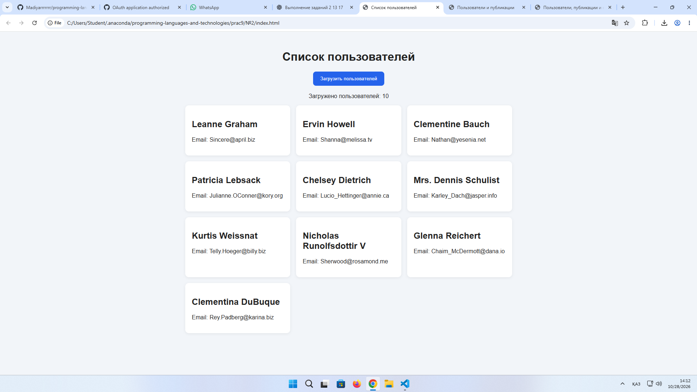
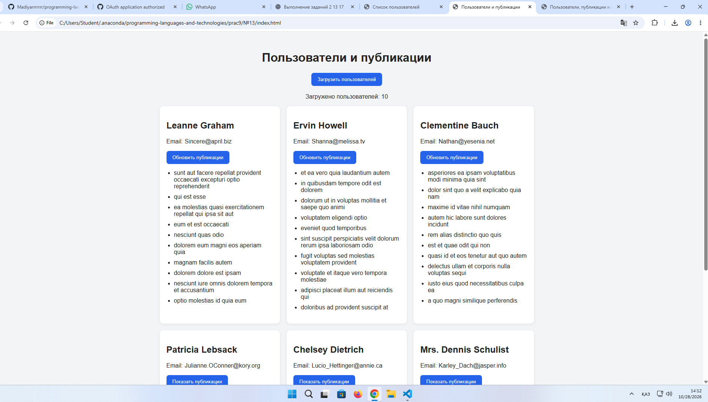
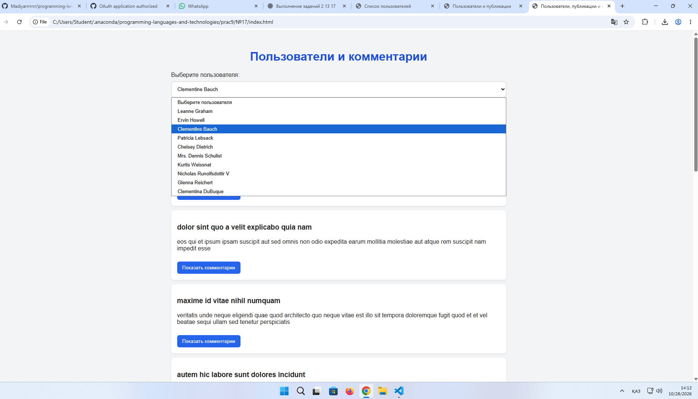

ОТЧЁТ ПО ЛАБОРАТОРНОЙ РАБОТЕ №9
Дисциплина: «Языки и технология программирования»

Тема: Асинхронные запросы (Fetch API, AJAX): получение данных с публичного REST API и отображение на странице.

Выполнил: Жантлеуов Мадияр

Группа: ИС 25-22

Выполненные задания: №2, №13, №17

СЛАЙД 1. Введение и цели работы
Цель работы
Цель лабораторной работы — освоить отправку асинхронных HTTP-запросов с помощью Fetch API, научиться получать данные из публичного REST API, обрабатывать JSON и динамически отображать информацию на веб-странице без её полной перезагрузки. Также необходимо научиться обрабатывать ошибки и отображать состояние загрузки данных.
Используемые технологии
- HTML5 — создание структуры веб-страниц.
- CSS3 — оформление пользовательского интерфейса.
- JavaScript — реализация логики приложений и обработка событий.
- Fetch API — отправка асинхронных HTTP-запросов.
- JSON — формат обмена структурированными данными.
- JSONPlaceholder — публичный учебный REST API.
- async/await — работа с асинхронными операциями.
- try/catch — обработка ошибок.
- Visual Studio Code — среда разработки.
- Live Server — запуск приложений в браузере.
Выполненные задания
Задание №2 — «Список пользователей».

Получить список пользователей из ресурса /users и вывести имя и электронную почту каждого пользователя.

Задание №13 — «Карточки пользователей с публикациями».

Создать карточки пользователей с кнопкой «Показать публикации», которая загружает публикации выбранного пользователя по нажатию.

Задание №17 — «Пользователь — публикации — комментарии».

Разработать интерфейс с последовательной загрузкой связанных ресурсов: выбрать пользователя, получить его публикации и загрузить комментарии к выбранной публикации.

СЛАЙД 2. Задание №2 — Список пользователей
Условие задания
Получить список пользователей из публичного REST API JSONPlaceholder и вывести на веб-странице их имена и электронные адреса.

Адрес API:

https://jsonplaceholder.typicode.com/users
Разбор задания
Для выполнения задания используется функция fetch(), которая отправляет GET-запрос на сервер. После получения ответа проверяется свойство response.ok. Если запрос выполнен успешно, данные преобразуются в формат JavaScript с помощью метода response.json().

Полученный массив пользователей обрабатывается с помощью метода forEach(). Для каждого пользователя создаётся отдельная карточка, содержащая имя и адрес электронной почты.

Для динамического отображения информации используются методы document.createElement(), append() и свойство textContent.

Основные этапы выполнения:
1. Пользователь открывает страницу приложения.
2. Нажимает кнопку «Загрузить пользователей».
3. Приложение отправляет запрос к API.
4. Сервер возвращает данные в формате JSON.
5. JavaScript обрабатывает полученные данные.
6. На странице отображаются карточки пользователей.
7. При возникновении ошибки появляется соответствующее сообщение.
Пример используемого кода
const response = await fetch(
    "https://jsonplaceholder.typicode.com/users"
);

if (!response.ok) {
    throw new Error(`HTTP ${response.status}`);
}

const users = await response.json();

users.forEach(user => {
    const card = document.createElement("div");
    card.className = "card";

    const name = document.createElement("h2");
    name.textContent = user.name;

    const email = document.createElement("p");
    email.textContent = `Email: ${user.email}`;

    card.append(name, email);
    usersContainer.append(card);
});

Демонстрация работы — тест №1
Начальное состояние:
- Открывается страница приложения.
- Карточки пользователей ещё не отображаются.
Действие:

Пользователь нажимает кнопку «Загрузить пользователей».

Результат:
- Отправляется запрос к серверу.
- Полученные данные отображаются в виде карточек.
- Для каждого пользователя показываются имя и электронная почта.
- На странице отображается количество загруженных пользователей.
При отсутствии интернет-соединения приложение выводит сообщение об ошибке загрузки.
Результат
Разработано веб-приложение для получения и отображения списка пользователей. Реализованы асинхронные запросы, обработка JSON, динамическое создание элементов страницы и обработка ошибок.

Скриншот: 

СЛАЙД 3. Задание №13 — Карточки пользователей с публикациями
Условие задания
Создать карточки пользователей с кнопкой «Показать публикации». При нажатии на кнопку необходимо загружать и отображать публикации выбранного пользователя.
Разбор задания
В начале работы приложение получает список пользователей из ресурса /users. Для каждого пользователя создаётся карточка, содержащая имя, электронную почту и кнопку для загрузки публикаций.

При нажатии на кнопку выполняется запрос к ресурсу /posts с параметром userId. Благодаря этому сервер возвращает публикации, принадлежащие конкретному пользователю.

Пример адреса запроса:

https://jsonplaceholder.typicode.com/posts?userId=1

Полученные публикации отображаются внутри соответствующей карточки. Для вывода заголовков используется свойство textContent.

Во время выполнения запроса кнопка временно блокируется, а пользователю показывается сообщение о загрузке. Если возникает ошибка, приложение выводит сообщение и позволяет повторить запрос.
Алгоритм работы
1. Загрузить список пользователей.
2. Создать карточки пользователей.
3. Добавить в каждую карточку кнопку «Показать публикации».
4. При нажатии отправить запрос к API.
5. Получить публикации выбранного пользователя.
6. Отобразить заголовки публикаций внутри карточки.
7. Обработать возможные ошибки загрузки.
Пример используемого кода
button.addEventListener("click", async () => {
    button.disabled = true;
    postsContainer.replaceChildren();

    try {
        const response = await fetch(
            `https://jsonplaceholder.typicode.com/posts?userId=${user.id}`
        );

        if (!response.ok) {
            throw new Error(`HTTP ${response.status}`);
        }

        const posts = await response.json();

        const list = document.createElement("ul");

        posts.forEach(post => {
            const item = document.createElement("li");
            item.textContent = post.title;
            list.append(item);
        });

        postsContainer.append(list);
    } catch (error) {
        postsContainer.textContent =
            `Ошибка загрузки: ${error.message}`;
    } finally {
        button.disabled = false;
    }
});

Демонстрация работы — тест №2
Действие 1: пользователь загружает список пользователей.

Результат: на странице отображаются карточки с именами и электронной почтой.

Действие 2: пользователь нажимает кнопку «Показать публикации» в одной из карточек.

Результат: приложение загружает публикации выбранного пользователя и отображает их заголовки.

Действие 3: пользователь повторно нажимает кнопку.

Результат: выполняется повторный запрос, а список публикаций обновляется.
Результат
Создано приложение с интерактивными карточками пользователей. Реализована динамическая загрузка публикаций по нажатию кнопки, обработка состояний загрузки и отображение ошибок.

Скриншоты: 
СЛАЙД 4. Задание №17 — Пользователь, публикации и комментарии
Условие задания
Создать интерфейс «Пользователь — публикации — комментарии» с последовательной загрузкой связанных ресурсов. Пользователь выбирается из списка, после чего отображаются его публикации. При нажатии на кнопку выбранной публикации загружаются связанные комментарии.
Разбор задания
В данном задании используются три ресурса JSONPlaceholder:
- /users — список пользователей.
- /posts?userId={id} — публикации выбранного пользователя.
- /posts/{id}/comments — комментарии к определённой публикации.
Сначала приложение автоматически загружает список пользователей. После выбора пользователя отправляется запрос для получения его публикаций.

Каждая публикация отображается в отдельной карточке с заголовком, текстом и кнопкой «Показать комментарии».

При нажатии на кнопку приложение получает комментарии к выбранной публикации. Для каждого комментария отображаются имя автора, электронная почта и текст.
Схема работы приложения
Загрузка страницы

↓

Получение пользователей — GET /users

↓

Выбор пользователя

↓

Получение публикаций — GET /posts?userId={id}

↓

Нажатие кнопки «Показать комментарии»

↓

Получение комментариев — GET /posts/{id}/comments

↓

Отображение комментариев на странице
Пример используемого кода
const posts = await fetchData(
    `https://jsonplaceholder.typicode.com/posts?userId=${userId}`
);

const comments = await fetchData(
    `https://jsonplaceholder.typicode.com/posts/${post.id}/comments`
);

comments.forEach(comment => {
    const item = document.createElement("div");
    item.className = "comment";

    const author = document.createElement("h4");
    author.textContent = comment.name;

    const email = document.createElement("p");
    email.textContent = `Email: ${comment.email}`;

    const text = document.createElement("p");
    text.textContent = comment.body;

    item.append(author, email, text);
    commentsContainer.append(item);
});

В приложении предусмотрена проверка response.ok, обработка ошибок с помощью try/catch и отображение сообщений о состоянии загрузки.

Для безопасного вывода информации используется textContent, чтобы полученные данные отображались как текст, а не как HTML-разметка.
Демонстрация работы — тест №3
Действие 1: пользователь открывает приложение и выбирает имя из списка.

Результат: загружаются публикации выбранного пользователя.

Действие 2: пользователь нажимает кнопку «Показать комментарии» у одной из публикаций.

Результат: приложение загружает и отображает комментарии, содержащие имя автора, email и текст.

Действие 3: пользователь выбирает другого пользователя.

Результат: список публикаций обновляется, а комментарии предыдущей публикации очищаются.

Действие 4: пользователь выбирает другую публикацию и открывает комментарии.

Результат: отображаются комментарии, связанные с новой публикацией.
Результат
Разработано приложение для последовательной загрузки связанных данных из REST API. Реализованы выбор пользователя, получение публикаций и комментариев, обработка ошибок и динамическое обновление интерфейса без перезагрузки страницы.

Скриншоты: 

СЛАЙД 5. Сводная таблица тестирования
В ходе тестирования проверяются загрузка данных, работа кнопок, отображение связанных ресурсов и обработка ошибок.
№	Проверка	Ожидаемый результат	Статус
1	Загрузка пользователей в задании №2	Отображаются имена и email	Заполнить после проверки
2	Отключение интернета	Появляется сообщение об ошибке	Заполнить после проверки
3	Загрузка карточек в задании №13	Отображаются карточки пользователей	Заполнить после проверки
4	Нажатие «Показать публикации»	Загружаются публикации выбранного пользователя	Заполнить после проверки
5	Повторная загрузка публикаций	Список обновляется	Заполнить после проверки
6	Выбор пользователя в задании №17	Загружаются его публикации	Заполнить после проверки
7	Загрузка комментариев	Отображаются комментарии выбранной публикации	Заполнить после проверки
8	Выбор другого пользователя	Список публикаций обновляется	Заполнить после проверки
9	Ошибка HTTP или сети	Отображается сообщение об ошибке	Заполнить после проверки
10	Повторная попытка загрузки	Запрос можно выполнить снова	Заполнить после проверки

Статус «Пройдено» следует указывать после фактического выполнения соответствующей проверки.
Дополнительные проверки
Задание №2:
- Проверить отображение имён и электронной почты.
- Проверить работу приложения без интернет-соединения.
- Проверить повторную загрузку пользователей.
Задание №13:
- Проверить загрузку публикаций разных пользователей.
- Проверить блокировку кнопки во время загрузки.
- Проверить повторный запрос публикаций.
Задание №17:
- Проверить загрузку публикаций выбранного пользователя.
- Проверить отображение комментариев.
- Проверить переключение между пользователями и публикациями.
- Проверить обработку ошибок сети.

СЛАЙД 6. Структура проекта и основные технологии
Структура файлов
Каждое задание реализовано в виде отдельного проекта, состоящего из трёх файлов.
Task2_Users/
├── index.html
├── style.css
└── app.js

Task13_UserPosts/
├── index.html
├── style.css
└── app.js

Task17_UserPostsComments/
├── index.html
├── style.css
└── app.js

index.html — содержит структуру страницы, кнопки, список выбора и контейнеры для отображения данных.

style.css — отвечает за оформление карточек, кнопок, публикаций, комментариев и адаптацию интерфейса.

app.js — содержит логику запросов к API, обработку событий, получение JSON и динамическое создание элементов страницы.
Основные методы JavaScript
- fetch() — отправляет HTTP-запрос к серверу.
- async/await — позволяет удобно работать с асинхронными операциями.
- response.ok — проверяет успешность HTTP-ответа.
- response.json() — преобразует JSON-ответ в данные JavaScript.
- try/catch — позволяет обрабатывать ошибки.
- finally — выполняет завершающие действия независимо от результата запроса.
- querySelector() — находит элемент по CSS-селектору.
- addEventListener() — назначает обработчик события.
- createElement() — создаёт новый элемент страницы.
- append() — добавляет элементы в DOM.
- replaceChildren() — очищает или заменяет содержимое элемента.
- textContent — устанавливает текстовое содержимое элемента.
- forEach() — перебирает элементы массива.
Особенности работы с API
JSONPlaceholder используется как публичный учебный REST API. Он предоставляет демонстрационные данные пользователей, публикаций и комментариев.

Асинхронные запросы позволяют получать информацию с сервера без полной перезагрузки страницы. Это делает интерфейс более удобным и позволяет загружать только те данные, которые нужны пользователю в конкретный момент.

СЛАЙД 7. Заключение и выводы
Итоги работы
В ходе лабораторной работы №9 были изучены принципы выполнения асинхронных HTTP-запросов с использованием Fetch API и получения данных из публичного REST API.

В задании №2 разработано приложение для загрузки списка пользователей. Реализовано отображение имён и электронной почты, а также обработка ошибок загрузки.

В задании №13 созданы карточки пользователей с кнопками для загрузки публикаций. Реализована подгрузка данных по нажатию, отображение заголовков публикаций и обработка повторных запросов.

В задании №17 создан интерфейс для последовательной загрузки пользователей, публикаций и комментариев. Реализован выбор пользователя, получение связанных публикаций и отображение комментариев к выбранной записи.
Полученные навыки
- Работа с Fetch API и REST API.
- Отправка асинхронных GET-запросов.
- Получение и обработка JSON-данных.
- Использование async/await.
- Обработка ошибок сети и HTTP-ответов.
- Работа с DOM и динамическое создание элементов.
- Обработка пользовательских событий.
- Создание интерактивных карточек.
- Последовательная загрузка связанных данных.
- Отображение состояния загрузки и сообщений об ошибках.
Общий вывод
В результате выполнения лабораторной работы были закреплены практические навыки взаимодействия веб-страниц с сервером посредством Fetch API. На примере трёх заданий изучены способы получения, обработки и отображения данных из REST API.

Использование JavaScript позволяет динамически обновлять содержимое страницы без её полной перезагрузки. Проверка HTTP-ответов и обработка ошибок помогают сделать приложение более надёжным и понятным для пользователя.

Таким образом, поставленная цель лабораторной работы достигнута: получены практические навыки работы с асинхронными запросами, JSON и динамическим обновлением DOM.

СЛАЙД 8. Контрольные вопросы
1. Что такое AJAX?

AJAX — это подход к обмену данными с сервером без полной перезагрузки веб-страницы.

2. Что такое REST API?

REST API — интерфейс, позволяющий получать и передавать данные через HTTP-запросы к определённым ресурсам.

3. Что возвращает функция fetch()?

Функция fetch() возвращает Promise, который после получения ответа обычно предоставляет объект Response.

4. Для чего используются async и await?

Они упрощают работу с асинхронными операциями и позволяют ожидать завершения Promise.

5. Почему необходимо проверять response.ok?

Потому что HTTP-ошибки, например 404 или 500, сами по себе не приводят к отклонению Promise, возвращённого функцией fetch().

6. Что делает метод response.json()?

Он читает тело ответа и преобразует JSON в соответствующее значение JavaScript.

7. Как обрабатывать ошибки сети?

Для обработки ошибок используется конструкция try/catch, внутри которой можно вывести сообщение пользователю.

8. Что такое CORS?

CORS — механизм безопасности браузера, определяющий, разрешено ли веб-странице обращаться к ресурсам другого источника.

9. Чем отличаются GET и POST?

GET обычно используется для получения данных, а POST — для отправки данных на сервер, например для создания записи.

10. Почему нельзя без проверки доверять ответу сервера?

Ответ может содержать неожиданные данные, отсутствующие поля или недоверенный текст. Поэтому данные необходимо проверять и безопасно отображать на странице.

11. Как показать индикатор загрузки?

Перед запросом можно установить текст элемента в значение «Загрузка...», а после завершения запроса обновить его содержимое.

12. Для чего нужен AbortController?

Он позволяет отменить поддерживающий отмену HTTP-запрос, если результат больше не нужен.

СЛАЙД 9. Дополнительное задание и практическое применение
Задание №2 — Список пользователей
В качестве дополнительной возможности можно реализовать поиск пользователей по имени или электронной почте. Это позволит быстрее находить нужного пользователя в списке.
Задание №13 — Карточки пользователей с публикациями
Можно добавить счётчик публикаций каждого пользователя или кнопку скрытия уже загруженного списка. Это сделает интерфейс удобнее при просмотре большого количества карточек.
Задание №17 — Пользователь, публикации и комментарии
Можно добавить фильтрацию комментариев по электронной почте автора или отображение количества комментариев к публикации. Это поможет удобнее изучать данные и находить нужную информацию.
Общий результат
Выполненные задания демонстрируют практическое применение Fetch API, JavaScript и REST API для создания интерактивных веб-приложений.

Первое приложение получает и отображает пользователей, второе загружает публикации по запросу пользователя, а третье обеспечивает последовательное получение пользователей, публикаций и комментариев.

В результате работы были закреплены знания об асинхронных запросах, обработке JSON, динамическом обновлении страницы и обработке ошибок. Полученные навыки могут применяться при разработке веб-сайтов и приложений, которые взаимодействуют с серверными данными.